# Project status and next gates

**Proposed realignment — 16 Oct 2026, 16:55 Lisbon (owner decision pending):** A track audit found that the 8–16 Oct local-file-intake proof chain has drifted away from the owner's goals: NinjaTrader live data, then NinjaTrader paper trading, then a controlled learning loop, then a live micro-contract pilot. The proposal is to PAUSE that chain (preserved, not deleted), make NinjaTrader 6E/M6E the primary track, scale rigor to risk (heaviest only at the order/money boundary), and start by running the existing NinjaTrader capture indicator. Nothing has been committed since 4 Oct. See [roadmap realignment](docs/ROADMAP_REALIGNMENT_20261016.md). Until the owner decides, every entry below stands unchanged.

**Final preservation handoff — 14:05 UTC, 2026-10-16:** [Complete actual2](logs/local_member_intake_recording_20261016_1/final_documentation_preservation_2.actual.json) observed13:59:49.4592790Z/tool exit0 and [independent full saved-data review](logs/local_member_intake_recording_20261016_1/final_documentation_preservation_2.independent_review.json) closed without Required findings: exact462registeredPython/rawmap50934bytes/H303fd546aac64f7688c04628c25496c6b2dcd822feda6d9ad168068d3a9ada0b, all456prewindow/233production unchanged,838distinctfreshpaths/838completeoccurrences/22,556,879bytes,376selectedmetadata/34MD/688local+5externallexicallinks/fiveunreleasedpathsabsent/staged0. All28explicitretained-unread occurrences have ZERO fresh verification credit; old505roster/77corpus/13external-native identities not reopened. Initial actual1 stdout was tool-truncated and remains NOT ACCEPTED; complete available fragment retained, no missing observations reconstructed. Independently reviewed delivery-only correction kept every preservation predicate/scope/cap/deadline and persisted the complete317,633-byte actual/H5f973e3c4e344d51d089021d4b1f7cd82c701ad61f793ac94473e10330aa2fbc before small stdout; no test/source/security change. [Status-only lineage](logs/local_member_intake_recording_20261016_1/final_documentation_delta_1.json) records final five-doc pins, only new-link metadata checks and independent delta closure, NOT another source/native/process/old688-link check. Pure2,447 and both sensitivity pairs remain accepted; wholeR1/protectedcleanup/R2/producer/nativeG4/filesystem/publicL1-L15/full-project regression/profile OPEN. All462Python/resources/contracts/plans/authors HOLD, no owned runtime pending. Only original15:28:38Zdeadline followup remains; no new work to fill time, no extension/archive/shutdown/next-day carryover. Routine permission established; older pending entries chronology.

**Current 13:46 UTC, 2026-10-16 — final pure2,447 independently ACCEPTED; source/runtime phase CLOSED:** [Final acceptance](logs/local_member_intake_recording_20261016_1/bootstrap_owner_pure_adjacent_1.acceptance.json) and [complete independent actual review](logs/local_member_intake_recording_20261016_1/bootstrap_owner_pure_adjacent_1.independent_review.json) close every1,927prewindow+275audit+245owner ordered, case-sensitive identity/0failures-errors-skips/all6,542ownerJSON/6,477graphs/310,011nodes/480,157edges/991oldAuditJSON/275wholepairs/80positiveunchangedgraphs/four complete unchanged warnings/full2,447-row lossless ledger/tool+three exact recorded exits0/462registeredPython+366fixedpins. Both [actual sensitivity pairs](logs/local_member_intake_recording_20261016_1/bootstrap_owner_sensitivity_complete_acceptance_1.json) independently closed intended unchanged assertion failures/exact finally base restorations after all roles settled/same affected GREEN. No owned runtime pending; NEVER repoll/requery/rerun completed subjects/readers/processes/quality/controls for status. [Scoped owner guide](docs/6E_LOCAL_MEMBER_INTAKE_BOOTSTRAP_OWNER_20261016.md) records pure-only support. All456prewindowPython/233production/olddeadline files unchanged; all462Python/resources/contracts/plans/authors HOLD. WholeRuff remains NON-GREEN with463held draft findings, not repaired or suppressed. WholeR1/protectedcleanup/R2governor/producer/nativeG4/filesystem/publicL1-L15/full-project regression/profile OPEN. Only final documentation/preservation/independent delta and ORIGINAL15:28:38Zdeadline followup remain. No further source/test/native increment or new work to fill time. Standing permission established; older pending/source-release paragraphs are chronology.

**Current 12:51 UTC, 2026-10-16 — T4.2 first245GREEN independently ACCEPTED:** [Complete independent actual review](logs/local_member_intake_recording_20261016_1/bootstrap_owner_behavior_green_1.independent_review.json) closed all245orderedpasses/0failures-errors-skips/all6,542completeJSON/6,477closedgraphs/310,011nodes/480,157edges/16declared+54refusal+28guardwholepairs/full245-rowlosslessledger/tool+three exact recorded exits0/459held+3=462/fixed289pins. No owned runtime pending, no completed-job requery or reassurance rerun. Only separately assigned NEWlog sensitivity controller/literal-packet preparation is active; all source/test/oracle and production HOLD. Two actual sensitivity mutations/exactfinallyrestores/sameaffectedGREEN and finalpure2,447 remain UNEXECUTED. WholeR1/protectedcleanup/R2/producer/native/filesystem/full-project/profile OPEN. Standing permission; same15:28:38Zhardend, older pending entries chronology.

**Current 12:28 UTC, 2026-10-16 — T4.2 source/NEW3quality closed, first behavior GREEN pending:** Complete [source review](logs/local_member_intake_recording_20261016_1/bootstrap_owner_source_review_1.json), [NEW3quality acceptance](logs/local_member_intake_recording_20261016_1/bootstrap_owner_quality_acceptance_1.json) and [full actual9-tree review](logs/local_member_intake_recording_20261016_1/bootstrap_owner_quality_diagnostic_ast_actual_review_1.json) passed. Mechanical formatting preserved all3whole ASTs; only separately reviewed1blankline+2explicit original diagnostic causes changed afterward, full expected ASTs reconcile without normalization. Final helper10,535bytes/H16ad81ec849e77d3f319f5a2767f35b3447a2e76777a760470a5a4d2ad2cbaea, primary55,387/H988ce6663a45d88a6cdae57d613c206553c756e0aa4b47c2858d43e57bbdd8e7, oracle50,412/Hdb379e9c217bd79f71043d6f8c1b682a3f12370e93cc4bb4a26ad58e75457a4f. Actual245intendedRED/518fullJSON already independently accepted; every writer HOLD, no owned pending. Same245implementedGREEN/6,542JSON/twoactualmutants-exactrestores/finalpure2447 still UNEXECUTED; root freshly registers pins before launch. All459pre-T4.2Python/233production/olddeadlines held; wholeRuff463oldfindings NOT repaired or rerun. WholeR1/protectedcleanup/R2/producer/native/filesystem/fullproject/profile OPEN. Same15:28:38Zhardend/standingpermission; older pending chronology.

**Current 12:07 UTC, 2026-10-16 — T4.2 actual intended RED accepted:** [Complete245RED](logs/local_member_intake_recording_20261016_1/bootstrap_owner_behavior_red_1.acceptance.json) and [independent full actual review](logs/local_member_intake_recording_20261016_1/bootstrap_owner_behavior_red_1.independent_review.json) close245intended missing-helper assertions/0errors-skips/all518typedJSON/22,134complete constructed literals/245source-bound NIE-direct-cause chains/full280,407-byte lossless ledger/tool1/three settled owned exits1,1,0/462registered459held+3 and196fixedpins. Collection245 also independently closed; no owned runtime pending or completed-job requery. Original exact670-byte stub snapshot retained. ONLY assigned NEW pure helper behavior is now released to Host; tests/oracle/accepted233production/459pre-T4.2Python/old drafts/deadlines HOLD. Same245GREEN/new3quality/sensitivity/finalpure2447 remain UNEXECUTED. WholeR1/protectedcleanup/R2/producer/native/filesystem/full-project/profile remain OPEN. Standing permission; unchanged15:28:38Zhardend. Older pending paragraphs chronology.

**Current 11:33 UTC, 2026-10-16 — T4.2 pre-run static gates CLOSED:** [Complete exact245 capture review](logs/local_member_intake_recording_20261016_1/bootstrap_owner_capture_counts_review_1.json) and [complete terminal correction closure](logs/local_member_intake_recording_20261016_1/bootstrap_owner_terminal_correction_review_1.json) passed. Retained initial checker needed actual capture_errors and exact source-bound NIE/direct-cause/finalAssertionError guards; corrected template2 preserves all other limits/identity/capture criteria. Full static test/oracle/21-node correction already closed. Every author HOLD; source still670-byte STUB, no behavior release. Root is materializing exact462/old459 collection and RED manifests/commands for independent final input admission; no collection/test/native/producer execution yet, no owned pending. Every459pre-T4.2Python/233production/olddeadline literal held. T4.1pure2,202 remains accepted; wholeR1/protectedcleanup/R2/producer/native/filesystem/full-regression/profile OPEN. Same15:28:38Zhardend/standingpermission; older pending entries chronology.

**Current 11:19 UTC, 2026-10-16 — T4.2 static correction CLOSED:** [Complete primary/oracle correction review](logs/local_member_intake_recording_20261016_1/bootstrap_owner_static_correction_review_1.json) closed the required post-operation graph gap. Same245unique IDs now use actual declared success/error/conversion-error/cut objects through four fresh owners per graph case; complete21-node before/after literals permit only the exact converter implicit-context alternative. Complete original snapshots retained. Tests49,744bytes/Hc62d4bfb2781e7c708ee123d50a093e0a3a09046761ff50988f614ef844f0e31; oracle50,586/Hd3faef8b28df6bc1de9d0b6189e231ec69e14bbd43f07688b542bcc890a72395. Source remains670-byte STUB/HOLD; no behavior until fully accepted actualRED. [Prospective per-case capture arithmetic](logs/local_member_intake_recording_20261016_1/bootstrap_owner_static_capture_counts_1.json) is under independent review; new terminal/report checker is authoring only. No collection/tests/imports/native/producer execution or owned pending. Every459pre-T4.2Python/233production/olddeadline literal held. T4.1pure2,202 accepted; wholeR1/protectedcleanup/R2/producer/native/filesystem/full-regression/profile OPEN. Same15:28:38Zhardend/standingpermission; older pending paragraphs chronology.

**Current 11:13 UTC, 2026-10-16 — T4.2 static correction, no runtime:** Complete primary245-case review found a real [raw-graph postcondition gap](logs/local_member_intake_recording_20261016_1/bootstrap_owner_primary_initial_review_1.json): identity alone could miss in-place mutation. ONLY the two existing declared-graph cases and independent literal context alternative are being corrected; exact245IDs stay fixed, complete original snapshots retained, source remains29-line670-byte STUB/HOLD. [Oracle review](logs/local_member_intake_recording_20261016_1/bootstrap_owner_oracle_review_1.json) and [wrapper462/old459 review](logs/local_member_intake_recording_20261016_1/bootstrap_owner_wrapper_review_1.json) closed their original scopes; new oracle/primary deltas still need full review before root collection/actual intendedRED. [Capture-policy correction](logs/local_member_intake_recording_20261016_1/bootstrap_owner_capture_policy_review_1.json) explicitly marks unavailable stub actual states, never fabricated. All459pre-T4.2Python/233production/olddeadline literals unchanged, no owned runtime pending. T4.1pure2,202 remains accepted; no repeat reassurance checks. WholeR1/protectedcleanup/R2/producer/native/filesystem/full-regression/profile OPEN; same15:28:38Zhardend and standing permission. Older pending paragraphs chronology.

**Current 10:50 UTC, 2026-10-16 — narrow T4.2 authoring only:** Main and Worker completed the [pure Host-owner contract](docs/6E_LOCAL_MEMBER_INTAKE_BOOTSTRAP_OWNER_CONTRACT_20261016.md) review; [both Required clarifications closed](logs/local_member_intake_recording_20261016_1/bootstrap_owner_contract_review_1.json), current27,741bytes/H155f319d297b78ff3166c260b9879dd621da3ce62d2306aec38747004ce11e3b, original snapshot preserved. [Exact authoring registration](logs/local_member_intake_recording_20261016_1/bootstrap_owner_authoring_registration_1.md) releases ONLY three NEW pure paths: Host signature/NIE stub (670bytes/H1f0e52ce587536883d805ed1b3ddd96a8081426f3d72136b25e19b59cb70ae34, nowHOLD), independently owned primary tests and literal oracles. No state/guard/retention implementation before complete intendedRED; no author runtime. Exact IDs/count/462source-set/runtime admission are not yet derived—~241 is only an outline. Preexisting459Python/233production remain unchanged; original deadline literals held. The [new pure wrapper proposal](logs/local_member_intake_recording_20261016_1/bootstrap_owner_pure_wrapper_delta_1.json) is under independent review, not a runtime release. [Early-failure gap design](docs/6E_LOCAL_MEMBER_INTAKE_EARLY_FAILURE_PROTOCOL_GAPS_20261016.md) records Worker/Root negative-carrier requirements only, no schema/magic/revision allocated. No owned runtime pending; T4.1pure2,202 remains accepted, no reassurance reruns. WholeR1/protectedcleanup/R2/producer/native/filesystem/full-regression/profile OPEN. Same15:28:38Zhardend/standingpermission; older scope/pending entries chronology.

**Current 10:36 UTC, 2026-10-16 — T4.1 pure support accepted:** [Final pure2,202 acceptance](logs/local_member_intake_recording_20261016_1/worker_audit_pure_adjacent_2.acceptance.json) and [complete independent actual review](logs/local_member_intake_recording_20261016_1/worker_audit_pure_adjacent_actual_review_1.json) close every1,927old+275new ordered identity/0failures-errors-skips/991complete JSON/275entire pairs/80unchanged graphs/536raw occurrences; full XML110,601,260bytes/H4b067ec066135359346771a69ae08ce15ea983a219b53381eebd07290c95e8f2, full lossless2,202-row ledger, four unchanged S2warnings, actual tool/all3exact owned exits0,459registeredPython+162fixed pins. No owned runtime pending; do not repoll/requery/rerun completed cases, collection, mutations, quality or old native controls for status. [Scoped guide](docs/6E_LOCAL_MEMBER_INTAKE_WORKER_OCCURRENCE_AUDIT_20261016.md) documents this pure-only acceptance. NEW3quality isGREEN; wholeRuff remains NON-GREEN with the same463held draft findings. All456prewindowPython/233production and finalnew3 remain unchanged/HOLD. [Diagnostic-envelope review](logs/local_member_intake_recording_20261016_1/diagnostic_envelope_review_1.json) closes source-derived arithmetic only; temporary-owner loss and Worker/Root early-failure carrier gaps remain real. WholeR1/protectedcleanup/R2/producer/native/filesystem/full-project regression/profile remainOPEN. Only two separately assigned new documentation paths (pure Host-owner contract and early-failure protocol-gap design) are being drafted; no new code/test/resource/native release. Standing permission/no approvalrepeat; original15:28:38Zhardend unchanged. Older pending paragraphs are chronology.

**Current10:14UTC2026-10-16:** [complete actual pure collection](logs/local_member_intake_recording_20261016_1/worker_audit_pure_collection_actual_review_1.json) has all2202unique requiredidentities/0executed/tool+3owned0/459+136pins. Original exactORDER expectation refused; oldmetadata had two historicallyappended metaclassIDs. [Onlytwo source-ordered moves](logs/local_member_intake_recording_20261016_1/worker_audit_collection_order_correction_1.json)/[independent closure](logs/local_member_intake_recording_20261016_1/worker_audit_collection_order_review_1.json) preserveeverycase/allother2200relativeorder, noassertion/filter/sourcechange. Originalinputs/refusal retained; no recollect, fresh executionmanifest2 still pending. [Complete ordinaryOwned static review](logs/local_member_intake_recording_20261016_1/ordinary_owned_bound_review_1.json) closes correctedconditionalbounds6084457/3503631 below8MiB, originalsnapshot retained aftercaseC28->30/+2 correction; NOT wholeR1/runtime/cleanup. Newdiagnostic-envelopes doc saved/HOLD forcompleteindependentreview, not acceptednativeproof. All456old/233production/new3finalqualitycode held, no ownedruntimepending. Same15:28:38Zhardend; standingpermission/no approvalrepeat, olderpendingchronology.

**Current09:58UTC2026-10-16:** [complete sensitivity/restore review](logs/local_member_intake_recording_20261016_1/worker_audit_sensitivity_actual_review_1.json) closes both real intended scalar mutations/completefullauditdefects/exactfinallybase restorations and same2GREEN (10fullJSON/twofullpairs/graphs/tool+3owned0). [Complete quality review](logs/local_member_intake_recording_20261016_1/worker_audit_quality_actual_review_1.json) closes NEW3Ruff/format0, full lossless AST packets and only2explicitzipFalse+2equivalenthexformat ASTchanges; fulltestAST/constants preserved. WholeRuff remains NON-GREEN: all463heldunqualifieddraft findings exactly unchanged/unfixed, no suppression. Source35416/Hdbd11de8a3d2cc989cf005ef21b1a95bfc3d2128f082ff5e28f437557f25dbd8; test87746/H6803f5cef8d917c5f653a8503262bad7307165231807a5b7e14547e5c81d5fdd; oracle56709/H10ed48331ba38f85b444974812b980813dc2cd188a9ba1edb46760abd0e76916. [Final pure2202 prospectus](logs/local_member_intake_recording_20261016_1/worker_audit_pure_adjacent_registration_1.md) saved, exactcollection/integration pending; all456prewindow/233production held. No ownedruntimepending; no repoll/recheck/rerun completedchecks for status. WholeR1/protectedfailure/R2/producer/native/filesystem/fullregression/profile OPEN. Same15:28:38Zhardend/standingpermission; older pending paragraphs chronology.

**Current09:34UTC2026-10-16:** [complete275GREEN](logs/local_member_intake_recording_20261016_1/worker_audit_green_1.acceptance.json)/[independent actual review](logs/local_member_intake_recording_20261016_1/worker_audit_green_actual_review_1.json) accepted: same275ordered IDs/0F-E-skips/all991completeJSON/275fullpairs/80unchangedgraphs/536rawoccurrences/exact3ownedexits0/459rawset+61fixedpins. Pure accounting only, not wholeR1/P3/native/cleanup/profile. No owned runtime pending; never repoll/recheck completed runs for status. [Two exact sensitivity changes](logs/local_member_intake_recording_20261016_1/worker_audit_sensitivity_registration_1.md)/[complete prospective review](logs/local_member_intake_recording_20261016_1/worker_audit_sensitivity_preparation_review_1.json) closed for preparation only; per-mutant manifests/admission/actual intended assertions/exact finally restoration remain mandatory. Quality/fullAST/pure-adjacent pending. All456prewindow/233production unchanged, standing permission; same15:28:38Zhardend. Older pending paragraphs are chronology.

Current2026-10-16 T4.1 source implementation is saved and completely reviewed against the pinned contract/P3/R3, no Required finding. Same275GREEN/quality/pureintegration are pending, not accepted yet. All456old/233production unchanged and all authors HOLD for root launch. New finite Host whole-M protected-tail construction is statically reviewed, but the shared native Times8/8-versus-P3null/8 mismatch remains OPEN in untouched drafts. WholeR1/R2/native/filesystem/regression/profile remain OPEN.

Current08:55UTC2026-10-16: new pure occurrence helper's complete275 intended RED passed its independent actual-evidence review. Full XML/captures/three owned exits/frozen pins are retained in [actual review](logs/local_member_intake_recording_20261016_1/worker_audit_actual_review_1.json). Only new audit-source implementation is released; tests/oracles/456old/233production remain unchanged. Same275 GREEN/full independent source review are pending. WholeR1/protectedcleanup/R2governor/producer/native/filesystem/regression/profile remain OPEN. The initial prelaunch paragraphs below are chronology.

Current2026-10-16 T4.1 prelaunch: the complete independent275-case occurrence suite and literal oracle are saved/static-review accepted; only a new source signature stub exists. Root will collect275 and require all275 intended missing-behavior RED before pure implementation and same275 GREEN. No tests/native/implementation executed today. All459registeredPython/currentresources/contracts/docs freeze during root launches; accepted233production unchanged. WholeR1/protectedcleanup/R2governor/producer/native/filesystem/fullregression/profile OPEN; same15:28:38Zhardend, no repeated routine approvals.

## Current — 2026-10-16 eight-hour recording/cleanup proof window

The three complete Host/Worker/RootExternal candidates now have [closed independent static reviews](logs/local_member_intake_recording_20261016_1/candidate_reviews_1.json); required Worker rawB/count corrections are closed with exact no-other-byte-change evidence. A narrow new [T4.1 submitted-tree occurrence audit](docs/6E_LOCAL_MEMBER_INTAKE_WORKER_OCCURRENCE_AUDIT_CONTRACT_20261016.md) has [two complete interface reviews](logs/local_member_intake_recording_20261016_1/worker_audit_interface_review_1.json) and [exact ownership/registration](logs/local_member_intake_recording_20261016_1/worker_audit_registration_1.md). Only a new signature/refusal/NotImplemented source stub and independent new test/oracle authoring are released; no implementation before actual intended RED, no runtime yet. It will preserve full input/M/raw-copy paths and numerical overages; numerical fit is expressly not native/P3/association/cleanup/continuation validity. WholeR1/R2/producer/native/files/fullregression/profile remain OPEN. All456old/233production and earlier deadline amendments stay unchanged; no owned job pending.

The human requested eight hours of work today; actual UTC start **07:28:38**, fixed stop **15:28:38UTC /16:28:38 Lisbon**. Continue recording and cleanup proof closure under the standing routine-permission waiver, with accepted production unchanged. See [today's window](docs/6E_LOCAL_MEMBER_INTAKE_RECORDING_WINDOW_20261016.md), [execution board](tasks/local_member_intake_recording_execution_20261016.md) and [prospective registration](logs/local_member_intake_recording_20261016_1/run_registration.md). The previous expired follow-up was deleted and replaced by today's bounded heartbeat; no old runtime is revived.

[R0actual](logs/local_member_intake_recording_20261016_1/baseline_1.json)/[completeactualreview](logs/local_member_intake_recording_20261016_1/baseline_review_1.json) accepted07:41:14.7699191Z: exact456registeredPython/233production unchanged,13fixed/2JSON/8selecteddocs/5absent/staged0;481distinct fresh files/714identity occurrences. Preservation only, not runtime/process proof. Three separately assigned new Markdown [Host](docs/6E_LOCAL_MEMBER_INTAKE_HOST_CERTIFICATE_CANDIDATE_20261016.md), [Worker](docs/6E_LOCAL_MEMBER_INTAKE_WORKER_CERTIFICATE_CANDIDATE_20261016.md) and [RootExternal](docs/6E_LOCAL_MEMBER_INTAKE_ROOT_CERTIFICATE_CANDIDATE_20261016.md) candidates are saved/HOLD under independent complete static cross-review. Root read each complete candidate. They identify full shapes/copy/count coupling and prospective corrected-source requirements, not a complete fitting certificate. No Python/test/machine-certificate/resource/producer/native/runtime writer released; wholeR1/schema/independent literal/incomplete-carrier gates remain OPEN. Yesterday's1,927pure and bridge15,037+3 remain historical accepted, not rerun. Complete R1 before R2governor, exact six-role integration before draft edits, actual registeredG4 before filesystem and every gate/credible reserve before regression/profile. Permission is established/no repeated approval request. No owned runtime pending. Older initial/frozen/deadline-only paragraphs are chronology, not broader release.

## Final recording/cleanup handoff — 2026-10-15

The one [actual new-task preservation](logs/local_member_intake_recording_20261015_1/final_documentation_preservation_1.json), exited0 at17:26:47.4966353Z, matched exact456registeredPython/452prewindow raw identities, unchanged233production,13R0dependencies,2newJSON and all132complete new-task artifacts. Its456map is50141canonicalbytes/SHA256`4c7a0786ef6f58d18a74dc74fca544ac74bd7260207d93142d9baf569411a61d`. All277selected local links resolve; staged0. Of505old relative pin occurrences,457were compared using already-fresh cache and48are explicitly retained/unread from unchanged containers—not a505-fresh-check claim. Thirteen external/native targets were not reopened. This is documentation preservation only, no test/native/process recheck. The [complete actual preservation review](logs/local_member_intake_recording_20261015_1/final_documentation_preservation_review_1.json) has no Required finding. [Final status-only lineage](logs/local_member_intake_recording_20261015_1/final_documentation_delta_1.json) links this snapshot to the four current-document changes without repeating preservation. All source/runtime/authors/reviewers HOLD; completeR1/R2/native/files/fullregression/profile remain open. Only the original19:12:58Zdeadline follow-up remains.

## Current — 2026-10-15 four-hour recording/cleanup continuation

The human authorized a new **15:12:58–19:12:58UTC /16:12:58–20:12:58 Lisbon** window specifically for recording and cleanup proofs, with accepted production unchanged and routine approvals established. The prior eight-hour window ended and its follow-up was deleted. See the [new window](docs/6E_LOCAL_MEMBER_INTAKE_RECORDING_WINDOW_20261015.md), [execution board](tasks/local_member_intake_recording_execution_20261015.md) and [prospective registration](logs/local_member_intake_recording_20261015_1/run_registration.md).

R1.1 pure envelope-calculator support and one source-qualified late-close **static sizing component** are verified. The [final related pure1927 aggregate](logs/local_member_intake_recording_20261015_1/late_close_pure_adjacent_1_acceptance.json), accepted17:06:07.2883746Z, includes every531+99+834priorpure,423calculator and40component identity, with zero failures/errors/skips, complete full937745-byte XML/H412837cdbb95aa444e15c9d03cb172b3c2ca14098fa8f9b17f54fe9c860081f2, all3actual owned exits0 and unchanged old/new pins. Complete independent evidence review closed without Required finding. Four unchanged old S2 deprecation warnings remain visible. Actual calculator mutations and one missing-copy packet mutation failed as intended; exact restoration and new-file quality/fullAST equivalence closed. The [cleanup derivation](docs/6E_LOCAL_MEMBER_INTAKE_CLEANUP_DERIVATION_20261015.md) preserves partial acquisition/reverse-release cuts, exact raw/copy costs and a proposed finite incomplete tail. None is an actual native-cleanup/whole-certificate claim.

Source/runtime phase is CLOSED: all456registeredPython under src/tests/scripts=452prewindowheld+4newpure files,2newJSON/resources/contracts/plans HOLD. All233acceptedproduction files and two prewindow test-support exceptions are unchanged. No owned runtime pending; do not poll session43989 or any completed data/mutant/earlier job or rerun accepted checks for status. CompleteR1ordinary/protected source-linked certificates, R2recording-governor/runtime integration, producer corrections, actual nativeG4/filesystem/publicprovider/full-regression/profile remain OPEN/UNEXECUTED. Only final documentation, one proportionate new-task preservation/link pass, independent final delta review and original19:12:58Zdeadline follow-up remain. Standing permission is not a blocker; no repeated approval is requested.

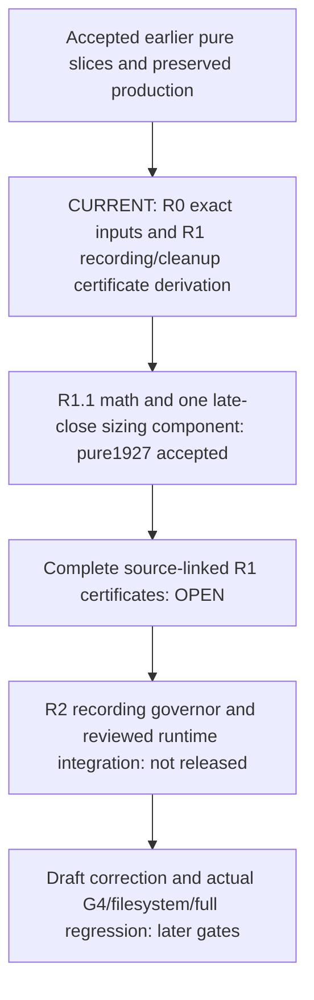

## Current — 2026-10-15 12:55 UTC preserved handoff; qualification incomplete

The [actual final documentation preservation](logs/local_member_intake_proof_20261015_1/final_documentation_preservation_1.json) passed at12:52:43.6258978Z: exact452registeredPython rawset/map,505heldrelativepinoccurrences, unchanged233-file production package, both raw freeze containers, current reviewed documents,77completeofficialbodies/4,328,045decodedbytes,231local-linkoccurrences across the eight selected Markdown files,13proposedartifactpaths absent and zero staged paths. The13external/nativeidentitypins were not reopened. This is raw identity/document preservation, not native or full-suite acceptance. The first orchestration attempt refused a package-relative cache lookup; its exact independently reviewed prefix correction passed without source/test/security changes or control reruns. This final status-only delta is linked to that snapshot separately; it does not repeat the preservation pass.

The source/runtime phase is closed for this window: prerequisite certificates and genuine recording-behavior tests are still absent, so they cannot justify corrected source/native qualification before the registered12:50edit-freeze/13:10latest-full-suite limits. No new source, test, resource, native control or full-suite increment will start. Only the final documentation/preservation/review and original **14:59:08Z** stop remain. No owned runtime is pending; no exited job or accepted check needs repolling/rerunning.

The [root occurrence map](docs/6E_LOCAL_MEMBER_INTAKE_ROOT_RECORDING_MAP_20261015.md), [actual cleanup/ownership continuation map](docs/6E_LOCAL_MEMBER_INTAKE_CLEANUP_CONTINUATION_MAP_20261015.md) and [ordered R0–R7 follow-up](tasks/local_member_intake_recording_followup_20261015.md) now make the open work concrete. Complete independent reviews/exact wording corrections are closed; they are accepted planning/source-map inputs only. The drafts still contain unsupported Peek-only EOF, incomplete whole-record admission/cleanup reservation and late pipe-ownership attachment. No positive profile, actual24-control cohort, filesystem qualification or complete regression is claimed. Standing permission is not an open gate.

Verified work today: S1 focused531, S2 reader99 plus actual55JSON/nineclock metadata, S3 focused834 with actual metadata-boundary RED→same2GREEN, and two presence-only interface GREEN identities. Each accepted check has its own complete identity/report/tool/owned-exit/pin evidence; these counts are not a single full-suite result. The earlier accepted bridge15,037passed+exact3skips remains historical acceptance, not a rerun today. All439otheroldPython/alloldproduction remain held, with only the two reviewed snapshot-preserved test-support window exceptions.

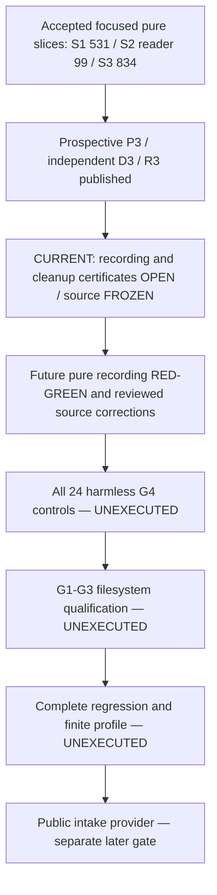

## Earlier — 2026-10-15 12:12 UTC recording-ledger gate

Update12:23UTC: the two exact ledger-design precision findings are [closed](logs/local_member_intake_proof_20261015_1/recording_ledger_design_review_1.json): the sizing grammar now has a source-qualified StringEnvelope and explicitly separates the still-open root recording proof. The complete action/cleanup certificates remain OPEN, so source/native qualification remains blocked. The corresponding two existing [producer/materializer presence assertions passed](logs/local_member_intake_proof_20261015_1/bootstrap_interfaces_green_1_acceptance.json), with exact2identities/zeroF-E-skips/tool0/ownedexit/452pre-postpins at12:20:42.7877663Z; this only proves the expected new files exist, not their behavior or a mandatory cohort. [77 retained official source bodies](logs/local_member_intake_proof_20261015_1/official_reference_index_5.json) total4,328,045decoded rawbytes; source text was not imported/executed. New source-linked root-occurrence and cleanup-continuation maps are being prepared as necessary next-gate inputs, not a runtime release.

The [P3/D3 binding acceptance](logs/local_member_intake_proof_20261015_1/bootstrap_eof_revision_binding_1_acceptance.json) is complete, with actual metadata tool/Python0, exact452pre/post registered Python pins and owned exit. Two independent complete actual-candidate reviews closed; [R3](logs/local_member_intake_proof_20261015_1/bootstrap_registration_3.json) was published byte-identically at12:08:17.7406450Z ([publication](logs/local_member_intake_proof_20261015_1/bootstrap_registration_3_publication_1.json)). These are prospective metadata, not native qualification. P3 requires an actual same-handle one-byte ReadFile FALSE/error109 for the selected EOF confirmation; a failed Peek109 is only its trigger, never EOF or nonblocking proof.

Static source review found incomplete whole-record budget accounting. The [complete proposed occurrence-ledger design](docs/6E_LOCAL_MEMBER_INTAKE_RECORDING_LEDGER_DESIGN_20261015.md) now maps Host20/Worker13/Marker13, every real duplicate carrier and the separate body/full-record caps. Its source-linked protected failure/cleanup continuation certificate remains OPEN; two independent design reviews are active. All new source authors are HOLD. The host/worker drafts still require reviewed EOF/accounting/R3 corrections; the reader/materializer/wrapper still need their corresponding prospective associations. No B/E/seal, native cohort, actual filesystem qualification or full regression exists yet. No owned runtime is pending. Routine permission is not the blocker.

All439other old Python files and all old production remain held; only the two precisely reviewed, snapshot-preserved test-support window exceptions apply. Target Python edit freeze12:50UTC/latest full suite13:10 only with credible complete acceptance reserve remain unchanged. If the prerequisite certificate cannot close in time, retain truthful incomplete evidence; do not launch late, omit mandatory cases or lower the bar. Hard end **14:59:08Z**.

## Earlier — 2026-10-15 10:55 UTC bootstrap source integration

Update11:23UTC: [P2/D2 binding](logs/local_member_intake_proof_20261015_1/bootstrap_revision_binding_1_acceptance.json) accepted11:10:47Z: all133schemas,489resolved references and72rules; complete independent eight-field D2 semantics unchanged by binding, existing budgets/controls/flags held, tool0/exact owned exit/pins. [Materializer intended RED](logs/local_member_intake_proof_20261015_1/bootstrap_materializer_interface_red_1_acceptance.json) accepted11:11:45Z as one executed missing-interface assertion/zero collection errors or skips. The new support materializer has been authored but not executed. R2's complete candidate has two independent static integration reviews; its [published body](logs/local_member_intake_proof_20261015_1/bootstrap_registration_2.json) is unchanged from that review. New producer/reader source is still being completed and reviewed; no actual G4/native/file experiment or new full regression follows from these metadata/interface milestones.

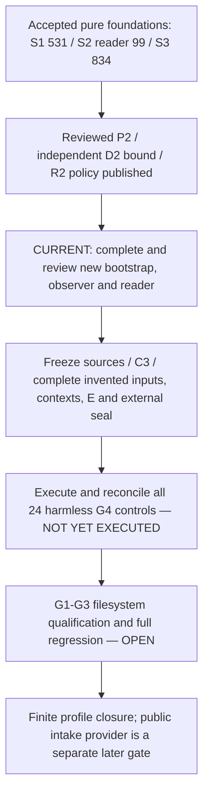

The three pure slices remain fully accepted (S1:531, S2 reader:99, S3:834; actual S2 metadata55JSON/nineclock). [Final R1 source-policy metadata](logs/local_member_intake_proof_20261015_1/bootstrap_registration_metadata_1_acceptance.json) was accepted10:34:41Z. The [actual intended missing-producer-interface RED](logs/local_member_intake_proof_20261015_1/bootstrap_producer_interface_red_1_acceptance.json) was accepted10:38:33Z: one executed intended assertion, zero errors/skips, actual tool/Python1, exact owned exit and pins. This released separate new host/worker, observer/module and independent-reader authors, not native execution.

Source integration found a real prospective schema gap: no carrier for complete worker API traces. [The binding refinement](docs/6E_LOCAL_MEMBER_INTAKE_BOOTSTRAP_BINDING_20261015.md) adds a v3 top-level result trace without increasing existing caps, distinguishes pre-emitter seals from externally observed delivery, and corrects the marker/host-observation ordering. P1/D1/R1 and accepted pure files stay unchanged; P2/D2/R2 and exact external joins remain under complete review. E, manifests, contexts, raw recipes, launch seal, C3 transfer and complete frozen sources are still prerequisites to any actual24-control G4 cohort. No actual G4/native/target-file proof or whole regression has executed today; no owned runtime is pending.

There are now exactly two snapshot-preserving, independently reviewed old TEST-SUPPORT exceptions: the qualification deadline and the [bridge-oracle receipt window](docs/6E_BRIDGE_ORACLE_WINDOW_AMENDMENT_20261015.md). All439otheroldPython and all old production code remain unchanged. Current source authors may edit only their assigned new files and hold for every root launch. Source/raw identities and75retained official reference bodies are not runtime/source authentication. Hard end remains **14:59:08Z**, target edit freeze12:50/latest complete suite13:10 only with credible full acceptance reserve. Earlier dispatch paragraphs are chronology.

## Current — 2026-10-15 09:48 UTC three pure slices accepted

S1 packet/error-bit helpers531, S2 reader99 and [S3 receipt validators834](logs/local_member_intake_proof_20261015_1/s3_receipt_focused_1_acceptance.json) have complete focused acceptance: every actual collected identity, zero failures/errors/skips, tool/Python0, exact owned exit and held pins. S3 includes an actual missing8MiB metadata-budget RED followed by the same two boundary identities GREEN; independent complete source/test/oracle and mechanical reviews are closed. No accepted helper run, exited process or focused suite needs repeating for status. The actual S2 pure root55JSON+9clock evidence remains accepted, not a Windows or filesystem proof.

P and final independently bound D are reconciled. The [unbound R proposal](logs/local_member_intake_proof_20261015_1/bootstrap_registration_unbound_proposal_1.json) retains explicit unresolved startup, source-manifest, observation and materialization facts; it is not final registration or source/native release. Fixed `-B -I` still requires exact global startup-source accounting; pinned official CPython source and bounded named static observations are being reconciled, with no interpreter/native/registry experiment. New native observer/host/worker, G4 controls, all G1–G4 filesystem qualification and public-provider L1–L15 remain unexecuted. No owned runtime is pending. All448currently registeredPython files are HOLD, including seven new pure source/test/oracle files; the sole old-code exception remains the approved snapshot-preserved qualification deadline literal, all440otheroldPython/oldproduction unchanged. Hard end remains **14:59:08Z**.

## Current — 2026-10-15 09:01 UTC pure root metadata accepted

The [actual pure root metadata run](logs/local_member_intake_proof_20261015_1/root_primitives_1_acceptance.json) is fully accepted: all55 independently fixed complete JSON vectors and nine literal clock cases, exact28False flags, complete canonical receipt/ownhash/source/vector identities, actual tool0, exact owned exit and held445Python/pins. This is not Windows bootstrap, file intake or G4 qualification. No owned runtime remains pending; do not repeat this run or the accepted S1 checks for status. The complete independent S2 reader test expansion has static review closed and is HOLD awaiting root collection/GREEN. P165082bytes/H38db088498a813aaf40d520fc7860e1ef70b45922b385525328e1dd75e2ceb89 and independent unbound D191906bytes/Hd5d5b126ae3a3dd49318653f17deda9dda069c18f5ccdf5cae4212dc0a912445 have both exact correction reviews closed. Root structural/canonical reconciliation and final real P-identity binding remain pending. Full native registration, receipt-validator RED/GREEN and harmless G4 controls remain open; host/worker/native observer mode and target-file calls are not released. Same14:59:08Z hard end and held scope apply.

## Earlier — 2026-10-15 pure slice accepted; bootstrap resource preparation

The native-free S1 slice is [fully accepted](logs/local_member_intake_proof_20261015_1/pure_green_1_acceptance.json):531passed, zero failures/errors/skips, every expected case-sensitive identity, tool/Python exit0, exact owned-process exit and held pins at07:55:02Z. Three new Python files are fixed HOLD; Ruff/new3format and complete AST/mechanical review passed. P protocol, independently authored unbound D expectations and root primitive vectors are now [resource-only drafts](logs/local_member_intake_proof_20261015_1/bootstrap_resource_preparation_1.md). No host/worker/observer code or Windows/file experiment is released until the complete relevant T2 registration closes. G1–G4 and public-provider L1–L15 remain unexecuted. The [single old qualification-test deadline exception](docs/6E_NATIVE_QUALIFICATION_DEADLINE_AMENDMENT_20261015.md) is snapshot-preserved and independently byte/guard reviewed; all440otheroldPython/oldproduction are unchanged. This does not rerun or revise S1's earlier acceptance. Hard end remains **14:59:08Z**; prior dispatch paragraphs below are chronology.

## Current — 2026-10-15 07:41 UTC pure implementation released

The [native-free S1 registration](logs/local_member_intake_proof_20261015_1/pure_slice_registration_1.md) and [accepted intended RED2](logs/local_member_intake_proof_20261015_1/pure_interface_red_2_acceptance.json) release one new pure packet/error-bit helper plus separate independent tests/oracles. Exact owned exit/tool1/one intended assertion/zero errors-skips/unchanged old441 and exact442set were reconciled. RED1 remains unaccepted due to incomplete root startup capture, with complete artifacts retained. Three source/design supplements have complete independent review/all Required corrections closed. Full native P/D/R/E registration, Windows bootstrap, G1–G4 closure and public-provider L1–L15 remain open; no file/API experiment has started. The prior three-document-author-only paragraph below is chronology. Same **14:59:08Z** hard end and all held scope/authority constraints apply.

## Current — 2026-10-15 eight-hour proof window

The human requested work for eight hours; actual start06:59:08UTC, hard end **14:59:08UTC /15:59:08 Lisbon**. [Today's window](docs/6E_LOCAL_MEMBER_INTAKE_PROOF_WINDOW_20261015.md) and [execution board](tasks/local_member_intake_proof_execution_20261015.md) govern. Yesterday's work was stopped and its heartbeat deleted. Current work closes the remaining bootstrap API/identity/literal-registration gaps, then advances only reviewed registered G1–G4 slices. Three documentation authors are active; no proof code or experiment is released yet. Routine permission is established.

All441accepted Python files/resources and prior15,037+exact3 acceptance remain held. T1PARTIAL/T2incomplete; G1–G4 and public-provider L1–L15 UNEXECUTED. Older deadlines/current-state entries below are chronology superseded by this direct renewal, not revived authority or pending old jobs.

## Current — 2026-10-14 18:55 UTC proof preparation reviewed

The [local intake preparation packet](docs/6E_LOCAL_MEMBER_INTAKE_PROOF_PREPARATION_20261014.md) retains46complete official reference files (45technical bodies plus one licence,4,199,667rawbytes), three concrete ABI/admission/bootstrap candidates and a saved-error FFI policy. Complete independent static reviews and exact corrections have closed with no Required candidate finding: [review record](logs/local_member_intake_proof_20261014_1/preparation_review_1.json). The corrected bootstrap proposal accounts for complete diagnostic copies and explicit unobserved/failed/valid states. T1 remains PARTIAL and T2 incomplete; all G1–G4/runtime checkpoints and public-provider L1–L15 remain UNEXECUTED.

The code-freeze target arrived before the source/registration prerequisites were complete. No new proof code, fixture, filesystem/native experiment, qualification-test deadline change or late full suite will start in this window. Accepted441Python/resources and prior15,037passed+exact3skips remain held. Standing permission is established; no approval question is pending. The hard end remains **20:10:52UTC /21:10:52 Lisbon**.

Final preparation preservation at18:58:56Z matched the exact441registeredPython set/rawhashes, canonical map/package,505relativepinoccurrences, both freeze containers, seven extra held documents and all46retained reference files. All220local Markdown link occurrences resolved, zero staged paths, eight proposed code/resource/fixture paths absent;13external/native identity pins were not reopened. [Receipt](logs/local_member_intake_proof_20261014_1/preparation_preservation_1.json). This closes documentation preservation; T1/T2 and all filesystem runtime gates remain open. The receipt retains the pre-final-status document snapshot; subsequent status-only text is recorded separately.

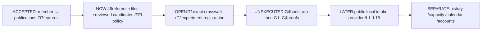

Earlier current/pending/deadline entries below are preserved chronology, not another active permission or runtime job.

## Current renewal — 2026-10-14 16:10:52 UTC

The human requested four more hours after the previous window closed. The [new local intake proof window](docs/6E_LOCAL_MEMBER_INTAKE_PROOF_WINDOW_20261014.md) ends **20:10:52UTC /21:10:52 Lisbon**. [Execution board](tasks/local_member_intake_proof_execution_20261014.md): T1official SDK/ABI/schema/mechanism preparation is active with three independent read-only source/architecture tasks. No code or runtime author is released yet. Exact T1/T2 prerequisites and new harmless containment controls precede registered invented-input filesystem qualification. Standing permission remains established.

Accepted441code/resources/oldcontracts/plans and prior15,037+3 acceptance stay held. The public intake provider, archives/history/accounts/models remain later work. Earlier documentation-only/no-plan/expired deadline entries are chronology; the new window governs this bounded proof increment.

## Current continuation — local intake proof planning / T1 partial

The direct human `continue`, checked14:51:41UTC, advanced documentation into a [dated G1–G4 proof plan](tasks/local_member_intake_g1_g4_plan_20261014.md) and [task list](tasks/local_member_intake_g1_g4_todo_20261014.md). Both complete independent static planning reviews passed with no Required finding. Twelve ordered tasks/four checkpoints put process/transport containment before filesystem experiments and end at the exact reviewed finite filesystem profile; public intake-provider implementation remains a later step. Routine permission is established and no plan-approval question is pending.

[T1 reference preparation](docs/6E_LOCAL_MEMBER_INTAKE_REFERENCE_PACKET_20261014.md) is PARTIAL: thirteen official SDK documentation body pins at an immutable commit and an initial semantic matrix are saved. Exact ABI/schema/admission mechanism and complete locally retained references remain incomplete. All four filesystem proof gates, runtime tasks/checkpoints and fifteen public-provider acceptance groups are UNEXECUTED. Accepted441Python/resources/oldcontracts/plans and the13:33:18qualification literal stay held; prior15,037+3 runtime acceptance stays closed. The current documentation window still ends **16:09:49UTC /17:09:49 Lisbon**.

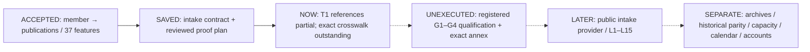

Earlier no-plans/stop-before-planning wording below is preserved chronology superseded for these documentation steps by the direct continuation. Evidence prerequisites and the deadline remain in force. No filesystem/native experiment or new runtime job was launched.

## Current renewal — 2026-10-14 12:09:49 UTC

The human requested four more hours. The [local member-file intake contract window](docs/6E_LOCAL_MEMBER_INTAKE_WINDOW_20261014.md) ends **16:09:49UTC /17:09:49 Lisbon**. The [saved proposal](docs/6E_LOCAL_MEMBER_INTAKE_CONTRACT_20261014.md) now has two independent complete static reviews and exact Required-finding closures: [review receipt](logs/local_member_intake_contract_review_20261014_1.json). It specifies one registered invented regular file, complete same-object byte capture and unchanged bridge composition. Verification does not reopen the file; file/attempt observations remain separate from stable content and old causal publication identities.

**Documentation accepted; filesystem qualification and implementation unexecuted.** Four proof gates remain: platform representations, root/object/race admission, complete read/EOF and resource/lifecycle containment. All15proposed acceptance groups and the exact OS/profile annex remain unexecuted. The proposal does not authenticate ownership/source or authorize archives/history/accounts. Source/test files and execution plans were not created; all accepted441Python/old contracts/plans remain held, including the qualification test's13:33:18literal. The completed15,037+3 acceptance below is not reopened. Earlier deadline-only statements are superseded chronology, not pending runtime work. The specification workflow stops here before planning/tasks/code, without repeating routine approval questions.

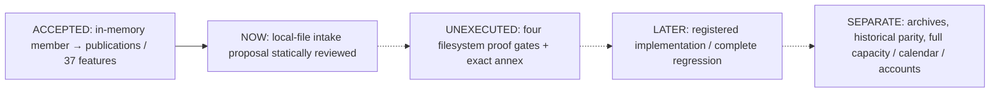

## Final handoff — 2026-10-14 12:04 UTC

The bridge implementation, full runtime acceptance and documentation handoff are complete. Independent final documentation review has no Required finding. The one documentation-preservation pass at12:04:15Z matched441registeredPython files,505relative pin occurrences and both freeze containers; all177local Markdown links resolved, zero paths staged. The13held external/native identity pins were not reopened. [Preservation](logs/source_publication_bridge_20261014_1/final_documentation_preservation_1.json), [review](logs/source_publication_bridge_20261014_1/final_documentation_review_1.json). The bounds table is explicitly a summary, with the complete linked protocol controlling every inner limit.

No owned runtime or author work remains pending. Only the original13:33:18UTC deadline follow-up remains; no new implementation, reruns or duplicate review. The accepted15,037+3 result and current flowchart below remain the current stage. Earlier preservation/review-pending entries are retained chronology.

## Current — 2026-10-14 11:58 UTC member-publication bridge fully verified

The bounded member-to-publication bridge is implemented and its complete regression is **fully accepted**. Session17734 exited0: **15,037passed + exactly3expected skips** in2,582.27seconds. Root acceptance at11:58:03Z reconciled all15,040case-sensitive identities (every13,543old + exactly1,497new), zero failures/errors, exact old skip XML, all245old/new receipt records and complete independent bodies, limits/cleanup, exact owned exit and518frozenpinoccurrences/441registeredPython. [Full acceptance](logs/source_publication_bridge_20261014_1/full_1_acceptance.json). Report43,177,040bytes SHA256`555b2928eb1d8a3ba392813df5c3810332430b15156e115ba5717d55f9d6db41`; JUnit2,574.514seconds.

No owned runtime remains pending. Do not poll17734/recheck exited jobs or repeat accepted suites, controls, verifiers, examples or reviews for status. All code/resources/contracts remain frozen. Focused1,497 and adjacent6,231 are also accepted. Only final documentation preservation and independent handoff review remain before the original13:33:18UTC stop; no further increment is released.

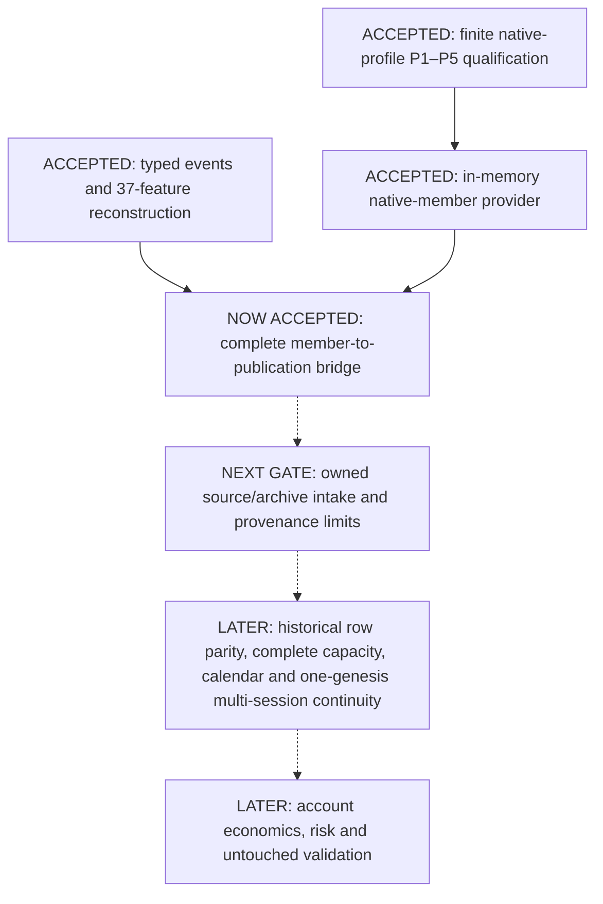

Read the [new guide](docs/6E_SOURCE_PUBLICATION_BRIDGE.md), [current task list](tasks/source_publication_bridge_todo_20261014.md) and [window](docs/6E_SOURCE_PUBLICATION_BRIDGE_DEVELOPMENT_WINDOW_20261014.md). This is finite invented-input consistency, not source/runtime authentication, historical validation, a profitable strategy or model improvement. All authority flags remain false. The BTC/cloud track is untouched. Older current/pending diagrams and entries below are chronology, not active work.

## Current — 2026-10-14 10:44 UTC focused and adjacent accepted / full running

The focused1,497 and adjacent6,231 cases are fully accepted, including complete new110native and adjacent old135receipt records, exact bodies, limits, cleanup, owned exits and frozen pins. [Adjacent acceptance](logs/source_publication_bridge_20261014_1/adjacent_1_acceptance.json). The first adjacent terminal wrapper refused a PowerShell scope mismatch; a separately reviewed seven-byte `script:` initializer correction passed against the same report, without changing code/tests or rerunning pytest. Original evidence remains retained.

The full15,040-case suite is now RUNNING as session17734, not accepted: expected15,037passes+exact3oldskipXML, every13,543old+1,497new case, complete old/new bodies and receipts. Exact launcher9752/child16296 command/executable/creation/parent records are in [launch](logs/source_publication_bridge_20261014_1/full_1_launch.json). All441registeredPython/resources/native artifacts/contracts are frozen; every writer HOLD, root terminal acceptance only. Earlier current entries are chronology. Hard end13:33:18UTC unchanged; no new increment after acceptance.

## Current — 2026-10-14 10:19 UTC final regression phase

Final formatting/whole Ruff and independent mechanical review pass. Both registered fault mutants were detected and exact source restoration passed the same cases. All15,040collected identities preserve13,543old+1,497new. The final focused1,497-case suite is running, not yet accepted; adjacent6,231/full15,040 remain pending. All441registeredPython and resource/native/contract pins are frozen, every writer HOLD. Root alone owns complete body/receipt/identity/exit reconciliation. [Current registration](logs/source_publication_bridge_20261014_1/run_registration.md). Earlier failures and intermediate states below are retained chronology; no repeated status checks or new increment. Hardend13:33:18UTC unchanged.

## Current — 2026-10-14 09:44 UTC expanded evidence retained / test correction accepted

The expanded1,103-case batch exited with1,039passes and64new sentinel-harness failures, not GREEN. Root reconciled all88actual native calls, including complete independent replay and submitted-verification bodies, exact receipts/ownership/cleanup/public-call associations and unchanged441registeredPython/505pinoccurrences. [Complete retained diagnosis](logs/source_publication_bridge_20261014_1/expanded_green_1_retained_diagnosis.json). The64failures arose because a test replaced a slot descriptor with a getter-only property, blocking fresh original construction;15count-sentinel passes could have been masked by the same cause. Both new-test-only setter-forwarding corrections were independently reviewed, and all79same identities now pass with zero native execution: [correction acceptance](logs/source_publication_bridge_20261014_1/sentinel_correction_1_acceptance.json). No production defect or Windows/security cause is established.

No owned runtime remains pending. Source/resource/oldproduction are HOLD. Separate new-test and rich-oracle authors are completing remaining provider-refusal, metadata/representation, operational/cap and timing cases; T7new-only mutants and finalB1–B15/focused/adjacent/full acceptance remain pending. Prior failed evidence is preserved, not relabelled. Root alone launches after all writers HOLD. The original13:33:18UTC hard end and all scope restrictions remain unchanged; older entries below are chronology.

## Current — 2026-10-14 09:09 UTC replay accepted / verifier under review

The complete initial replay cohort is fully accepted:287passed, zero failures/errors/skips,24actual native invocations with complete independently registered bodies, exact receipts/public-call observations/owned exits and504 pin occurrences reconciled. [Replay acceptance](logs/source_publication_bridge_20261014_1/replay_green_2_acceptance.json). The retained earlier24failures were an unsupported new test assumption about cumulative job process count; the exact reviewed oracle correction preserved active-child, final-empty, limit and exit requirements. No Windows/security cause is inferred.

The independent submitted-verification case then executed its intended missing-API failure with zero native calls; [verifier RED](logs/source_publication_bridge_20261014_1/verify_red_1_acceptance.json) is accepted. New verifier source is now stable for root/independent review, not runtime-accepted. Independent tests are adding distinct nested branches, scalar/getter, mapping, numerical, operational and capacity coverage; a separately authored new literal rich-oracle helper is under independent review. No runtime job is pending. Root alone may launch after every writer HOLD and fresh registration. Complete B1–B15, focused/adjacent/full regression remain pending; hard end13:33:18UTC unchanged. Earlier current entries are chronology.

## Current — 2026-10-14 08:38 UTC bridge replay implementation

Initial141 interface/context cases are fully accepted. Two complete independent invented minimal byte/body oracles and their positive receipt observer passed root/static review, with attempted-call counting and exact scalar receipt checks corrected before launch. The first complete replay case reached the intended missing-replay failure, not a collection/constructor accident: one failure, zero errors/skips/native attempts, exact owned exit and unchanged pins accepted08:38:17Z. [RED receipt](logs/source_publication_bridge_20261014_1/replay_red_1_acceptance.json).

The source author is now implementing complete replay in the new module only; verification remains deliberately unimplemented until its separate RED. The test author is preparing registered independent mapping/raw/causal and scoped preflight coverage. No actual native bridge composition or final regression is accepted yet. The new verification shape-admission clarification preserves the unchanged adapter's local metadata gate without passing arbitrary nested scalar containers into its recursive projector; see [registration](logs/source_publication_bridge_20261014_1/run_registration.md). Existing hard end13:33:18UTC and all held-code/scope boundaries remain unchanged. Earlier current entries below are chronology.

## Current — 2026-10-14 08:06 UTC foundation slice

Reviewed bridge plan/protocol and independent interface tests are ready. The first intended missing-interface RED is fully reconciled, including exact owned process identities/actual exit and unchanged pins; new source author is now implementing only records/protocol/context/preflight. Complete replay/native composition and full regression are not yet accepted. [Registration](logs/source_publication_bridge_20261014_1/run_registration.md).

The user authorized today's narrow qualification-test deadline fix. Complete previous snapshot is retained; independent byte/guard review confirms only the deadline literal changed, with all old production unchanged. [Amendment](docs/6E_NATIVE_QUALIFICATION_DEADLINE_AMENDMENT_20261014.md). Routine approval requests are waived. Hard stop remains13:33:18UTC; earlier pending wording below is chronology.

## Current — 2026-10-14 bridge continuation, planning first

The human renewed work for six hours: **07:33:18–13:33:18 UTC /14:33:18 Lisbon hard stop**. Read [today's window](docs/6E_SOURCE_PUBLICATION_BRIDGE_DEVELOPMENT_WINDOW_20261014.md). Root is advancing the reviewed member-to-publication contract into a dated execution plan, exact protocol and registration before any new implementation/native launch. Routine approvals remain waived; evidence and held-file boundaries remain in force. No new runtime has started and the bridge remains unimplemented at this initial entry.

Accepted provider code and its13,540+3 regression are complete. The old test harness's expired deadline is a concrete compatibility gate being inspected, not a reason to backdate, omit cases or silently alter held tests. Yesterday's documentation-only scope and stop time below are preserved chronology; the renewed bounded scope is recorded in today's handoff.

## Current — source/publication bridge contract, documentation only

The human's **add 3 more hrs**, recorded at **13:47:10 UTC on 2026-10-13**, extends the preceding stop time by three hours to **18:06:41 UTC / 19:06:41 Lisbon today**. The [new window](docs/6E_SOURCE_PUBLICATION_BRIDGE_WINDOW_20261013.md) releases only the next contract and read-only source inspection. Accepted code, data, contracts and completed plans remain unchanged. The accepted qualification-test deadline is **not** extended.

The [member-to-publication bridge proposal](docs/6E_SOURCE_PUBLICATION_BRIDGE_CONTRACT_20261013.md) is saved **PROPOSED / UNIMPLEMENTED**. Two complete independent static composition reviews and exact correction closure finished with no Required finding. It defines one bounded composition: complete supplied **invented** native-member bytes, the unchanged typed adapter and new causal publication links. It is not an archive reader, source authentication, historical replay or implementation. All fifteen proposed acceptance groups remain unexecuted. There is no active runtime job and no new code/test/native execution is released. The reviewed proposal is the completed documentation milestone; no implementation plan or task list has been created for it.

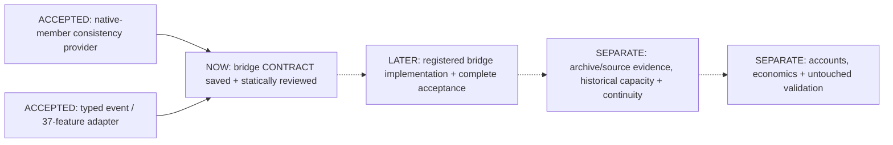

The new design preserves complete native and typed bodies, all foreign positions, the first due publication cursor and old caps. It rejects values outside the shared domain instead of coercing them, and separates whole-member/EOF hashes from consumed-prefix identities. Routine approval waiver avoids repeated approvals; it does not turn this documentation scope into implementation or historical authority. Earlier deadlines and pending statements below are retained chronology, not current instructions.

## Accepted provider milestone — 2026-10-13

At **13:26:57 UTC on 2026-10-13**, the complete provider regression was accepted: **13,540 passed + three expected skips = 13,543 unique cases**. Every 12,417 old identity and exactly 1,126 new identity matched; zero failures/errors, exact old skip reasons, complete native/control outputs, owned exits and frozen files were reconciled. The focused 1,126 and adjacent 4,734 cases were already accepted. See the [terminal acceptance receipt](logs/native_member_provider_20261013_1/full_1_acceptance.json), [provider guide](docs/6E_NATIVE_MEMBER_DECODE_EVIDENCE.md) and [run evidence](logs/native_member_provider_20261013_1/run_registration.md).

**Provider implementation and final handoff are complete; no owned runtime remains pending.** All 437 registered Python files under `src/`, `tests/` and `scripts/`, three new JSON resources and held evidence are frozen. The human-approved [one-line qualification deadline amendment](docs/6E_NATIVE_QUALIFICATION_DEADLINE_AMENDMENT_20261013.md) preserves its original complete snapshot; the other 427 old files and all old production code remain unchanged. Independent final documentation review closed its required wording correction; the 13:33:36 UTC preservation pass matched the registered files/pins, resolved 111 local links and found zero staged paths. Native binaries were not reopened. Only the original deadline follow-up remains: **15:06:41 UTC / 16:06:41 Lisbon**. Do not repeat completed checks or start another increment.

This is finite invented-member consistency, not source/feed/runtime authentication or historical validation. Archive intake, source-bound causal publications, original-row parity, complete historical capacity, calendar and one-genesis multi-session/account integration remain separate unimplemented gates. No profitable strategy, broker economics, model improvement or training/scoring/promotion authority follows; all 28 authority flags remain false.

```mermaid
flowchart LR
    P["Accepted: finite P1–P5 profile"] --> I["Accepted: interface + new host controls"]
    I --> N["Accepted: rich native + partitions + fault controls"]
    N --> F["Accepted: 1,126 focused cases; reviews closed"]
    F --> R["Accepted: 4,734 adjacent cases"]
    R --> A["Accepted: full regression 13,540 passed + 3 expected skips"]
    A --> D["NOW: provider and handoff complete; no runtime pending"]
    D -.-> H["NOT IMPLEMENTED: source / publication / history integration"]
    H -.-> V["Separate economics + untouched validation"]
```

## Earlier planning snapshot — 2026-10-13 provider continuation

The human returned with **continue** after stopping yesterday. The next bounded native-member provider now has a [dated execution plan](tasks/native_member_provider_plan_20261013.md), [task list](tasks/native_member_provider_todo_20261013.md) and [contained execution design](docs/6E_NATIVE_MEMBER_EXECUTION_DESIGN_20261013.md). Two independent complete static reviews found no required architectural or coverage issue; clarifications are incorporated. The selected architecture preserves the five byte-only APIs and runs native decoding in a new fixed private worker, never in the caller process. Exact execution-registration/receipt/parser/exit schemas remain T1 preparation; new host qualification and A1–A15 implementation are **UNEXECUTED**. This is design/planning progress, not new native/runtime acceptance.

All 428 accepted Python files remain held. The last accepted suite remains **12,414 passed + three expected skips = 12,417 unique identities**, not a new run today. No code, tests, native decoder, old-proof rerun, staging or commit was launched for this planning work. Routine approvals remain waived; technical gates remain. No new duration was specified, no expired timer was restarted and yesterday's deleted heartbeat remains deleted. Earlier timed/pending statements below are preserved history.

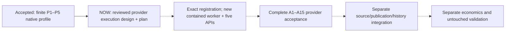

The next technical task is T1's exact execution registration, followed by native-free interface slices and new harmless worker controls. Neither a passing finite profile nor this reviewed plan establishes historical capacity, source/runtime authentication, broker economics, profitable strategy or model improvement. BTC/cloud work and all old source/target/input/result/control pins and UNKNOWN liabilities stay untouched.

## Previous closed milestone — 2026-10-12

**Current stage —18:21:38UTC:** **P1–P5 native-profile qualification and T12/C4 are complete**, with two independent final reviews and the exact profile/receipt published. [Closure and evidence](docs/6E_NATIVE_PROFILE_CLOSURE_20261012.md), [active board](tasks/native_profile_execution_20261012.md). The complete regression remains **12,414 passed, three expected skips, zero failures/errors**: all12,206old identities plus exactly211new, complete resources/owned exits and unchanged registered428-file/package/contract/native-artifact pins. The exact Python corpus is `src/`, `tests/` and `scripts/`: all418previously accepted files remain unchanged; ten new proof files are frozen too. This is not an all-folder file inventory. **Next: the unimplemented bounded native-member witness provider**, followed by source-bound publication/historical integration. No owned runtime or required closure review remains pending; no further source/test/native run is released in this window. Routine approvals remain waived. Hard stop is **2026-10-12 19:59:46UTC**. This is finite invented-input codec qualification, not historical validation, authentication or strategy performance.

## Dated authority and evidence history

Entries below retain earlier scopes and deadlines. The active board and six-hour handoff supersede their expired or approval-pending instructions.

**Latest six-hour renewal — 2026-10-12T13:59:46UTC:** direct continuation/no routine approvals/online-if-needed releases advancement of the saved P1–P5 proof plan until **19:59:46UTC (20:59:46 Lisbon)**. [New proof-window handoff](docs/6E_NATIVE_PROFILE_PROOF_WINDOW_20261012.md) supersedes the old15:12:16UTC/offline-only source retrieval restriction. Official version-bound source/documentation retrieval is now authorized; accepted418code/contracts/plans remain held. Initial phase is independent reference closure; no native import or proof-code/runtime launch before registration/containment prerequisites. No market/history/account/security/dependency permission follows. The prior local-reference gap below is a dated snapshot, not a current prohibition on authorized official retrieval.

**Source-availability answer — 2026-10-12T13:54:10UTC:** the human confirmed no offline DBN/Zstd reference copies. No additional corpus is available from that answer. T1 stays partial/technically blocked; there is no further routine approval question. Keep the offline constraint and accepted code unchanged; do not fetch network references or invent native format/oracle evidence. Original15:12:16UTC stop unchanged. Current window records the answer; reviewed reference inventory/progress pins remain unchanged.

**Latest continuation — 2026-10-12T13:34:44UTC:** direct “continue…no need to ask for approval…full permission” is treated as approval to advance the saved P1–P5 plan without repeated routine approval prompts. T1's safe read-only local-reference availability slice has now been investigated: [source inventory](docs/6E_NATIVE_PROFILE_REFERENCE_INVENTORY_20261012.md), [progress](tasks/native_source_evidence_p1_p5_progress_20261012.md). Two independent static reviews accepted the new evidence documents. **T1 remains PARTIAL/BLOCKED**, not complete: no independently authoritative DBN v3 wire-layout reference/complete literal oracle or complete Zstd format/resource oracle was identified in the bounded inspected corpus. This is an evidence gap, not an approval gap or claim about all PC files. A non-blocking question requested any existing offline official-reference folder. No fixture/harness/provider/test code or native process was created; P1–P5/all15provider groups remain unexecuted. All418acceptedPython files/approved contracts/reviewed plans held; original15:12:16UTC deadline unchanged. Earlier all-substeps-unexecuted labels are the planning snapshot; incomplete task checkboxes remain unchecked.

**Latest direct approval/planning request — 2026-10-12T13:13:32UTC:** the human approved the native/source-evidence contract and requested offline P1–P5 proof-closure planning in new dated task files. The [plan](tasks/native_source_evidence_p1_p5_plan_20261012.md) and [task list](tasks/native_source_evidence_p1_p5_todo_20261012.md) are saved planning proposals, accepted by two independent complete static reviews and exact-correction closure with no Required finding; all12proof tasks/fourcheckpoints remain UNEXECUTED. This is not native/profile closure or provider implementation. P5 static/load/final identity and P3 containment/empirical resource proof are separate stages; P2 uncompressed literal probes can proceed independently of full Zstd proof only in a later contained registered scope. C2 gates composed T9/P4, not that independent P2 branch. Any P1–P5 blocker forbids a positive closed-profile artifact/digest. Final planning-preservation13:30:26UTC matched all418files/eightheldcontract-planpins/oldfreeze, reviewed new-file pins and53local links; zero staged paths and proposed code paths absent. No runtime/native work is released. Original docs-only15:12:16UTC hard end unchanged; current request supersedes earlier contract-approval/stop-before-plans wording only for these planning documents. Present the plan/task list and stop before execution.

**Native/source-evidence specification saved — 2026-10-12:** [the complete-member contract](docs/6E_NATIVE_SOURCE_EVIDENCE_CONTRACT_20261012.md) is **PROPOSED / UNIMPLEMENTED**, with two independent static reviews and all Required corrections closed. Its five native-proof gates remain UNEXECUTED and implementation-blocking;15proposed acceptance groups are not runtime evidence. No execution plan/tasks/code/native experiment is released. [Current window](docs/6E_NATIVE_SOURCE_EVIDENCE_WINDOW_20261012.md) remains docs-only until15:12:16UTC; all418acceptedPython files/oldercontracts/plans stay held. The accepted constructed adapter remains our completed runtime stage; native member consistency, intake/publication composition and historical continuity are separate future gates. Present the specification and stop before plans/code; no repetitive approval of earlier accepted work is needed.

**New documentary renewal — 2026-10-12:** direct “yes” authorized another four-hour OFFLINE native/source-evidence contract window **11:12:16–15:12:16UTC (16:12:16Lisbon hardstop)**, keeping accepted code unchanged. Read [the new contract-window handoff](docs/6E_NATIVE_SOURCE_EVIDENCE_WINDOW_20261012.md). All418acceptedPython files/contracts/oldplans are held; no decoders, raw/historical inputs, tests/models/runtime, network/dependency/security changes, staging or commits. Only the proposed complete in-memory `native-member-witness` boundary is being specified; archive intake, publication integration, historical capacity/calendar/continuity and authentication remain separate gates. Prior typed-adapter acceptance below is COMPLETE, not another running job; the previous heartbeat was deleted and this renewal does not revive it.

**Current renewal — 2026-10-12:** the dated typed native/event adapter plan/task list is approved by the direct no-further-routine-approval message, and today's “continue for 4 hrs” released only its bounded offline implementation from **06:48:24 to10:48:24UTC (11:48:24 Lisbon hard stop)**. Follow [the implementation handoff](docs/6E_TYPED_NATIVE_EVENT_ADAPTER_DEVELOPMENT_WINDOW_20261012.md). The older documentation-only/approval-pending snapshot below is chronology. All416prioraccepted Python files stayed immutable; only the new pair was added, using invented fixtures, independent test-first slices and full frozen acceptance. All418files are now held; no native/history/trading authority follows.

**FULLY VERIFIED at2026-10-12T09:59:34UTC:** adapter implementation/static reviews,1,334focused/3,938adjacent cases, wholeRuff/newpairformat and frozen complete regression all accepted. Session68085 exited0: **12,203passed+exact3expectedskips**, all12,206unique identities=every10,872old+exactly1,334new, zero failures/errors, complete totals/skipXMLreasons/ownedexit/whole-old-new-package-contract-manifest pins reconciled. No owned runtime remains pending. [Terminal receipt](logs/typed_native_event_terminal_acceptance_20261012_1.json) and [current adapter guide](docs/6E_TYPED_NATIVE_EVENT_ADAPTER.md) record the evidence; this is a dated acceptance snapshot, not continuous environment monitoring. Do not repeat suites/process/verifier checks for status. All418Python files remain FROZEN; no further increment is released during remaining documentation-only time.

## Dated stage and flowchart — 2026-10-12

We have completed the constructed cursor, payload and typed event/37-feature layers, and now **closed the registered native-profile proof and exact schema/receipt** against official version-pinned references and independent invented bytes. The current complete suite is12,414passed plus three expected skips. **We are at a qualified profile, ready for a separately scoped public-provider implementation—not historical integration.** The native proof did not change the418 previously accepted Python files. All authority flags remain false; no strategy, broker or model-performance claim follows.

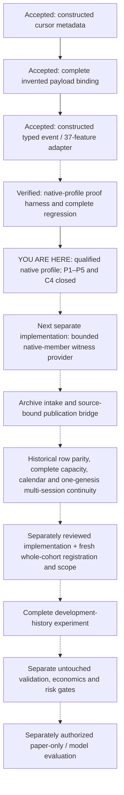

Solid arrows show accepted relationships or the completed proof-to-profile closure; dashed arrows show unimplemented integration/prerequisites, not a working end-to-end path. Complete native input consistency is not source/feed/runtime authentication. The current six-hour window now permits only final documentation/handoff; further native runs, provider implementation, historical experiments and account integration are not released. BTC/cloud collectors and their roadmap remain separate and untouched. The10:48:24UTC stop belongs to the earlier adapter window; today's current hard end is19:59:46UTC.

## Historical 2026-10-11 snapshot

The following body and flowchart preserve the earlier snapshot. Current2026-10-12 status above and today's handoff supersede its older approval-pending/not-implemented labels; it is not a second current-status claim.

Status date: **2026-10-11**. Latest accepted Python run: **14:16:22 UTC**. Current saved-evidence/file audit: **14:31:35 UTC**. This is a dated snapshot, not continuous environment monitoring.

## Where we are

The active **6E research track has completed its constructed payload-binding stage**. We can independently reconstruct complete invented raw-record bodies, their context and cursor identities, and reject inconsistent submitted results. The next **typed native-shaped event/publication contract** is [HUMAN APPROVED](docs/6E_TYPED_NATIVE_EVENT_ADAPTER_CONTRACT_20261011.md), not implemented. Direct offline planning/task-list preparation was authorized at15:24:39UTC and new dated-file placement was chosen at18:09:49UTC. The [execution plan](tasks/typed_native_event_adapter_plan_20261011.md) and [task list](tasks/typed_native_event_adapter_todo_20261011.md) are now saved **PROPOSED for human plan review**, with every implementation task unexecuted. We have **not** completed the native-to-historical research bridge or established a profitable strategy.

The latest complete Python regression is **10,869 passed, three expected skips, zero failures/errors**: all **10,872 case-sensitive unique identities**, exactly every previous 9,398 plus 1,474 new payload-binding cases. The current 416 Python source/test files still match that accepted freeze. No owned implementation/test/model/training job remains pending according to the terminal acceptance; this audit did not recheck exited processes or start a runtime job. Only documentation review was added for this request.

The wider repository also contains BTC Spot ingestion, causal features, research and opt-in paper components. Their existing roadmap and historical evidence remain separate; the 6E milestones neither replace that architecture nor validate a running BTC/cloud service. No collector was inspected, started, stopped or changed. Current complete Python regression covers collected cases, **not every possible environment, native backend, external service or trading behavior**. JavaScript tests and Windows/security health were not freshly checked here.

## Accepted component layers

These are bounded constructed components, not an already integrated historical pipeline. Counts below are coverage within the latest full report; other pre-existing tests also contribute to its total.

| Layer | Constructed cases | What is established | What is not established |
| --- | ---: | --- | --- |
| Native-prefix / admission assessment | 305 / 221 | Bounded causal-prefix and admission consistency | Real native/feed authentication or account authority |
| Single entry / single roundtrip | 161 / 239 | Isolated candidate entry/exit, deadline and declared-fee behavior | Original-strategy integration or broker fills |
| Liquidity point / funded path | 646 / 618 | Four independent fixed directions; bounded one-genesis causal accounting | Full historical capacity, multi-session continuity or profitability |
| Metadata cohort | 271 | Complete invented session/publication assertion consistency | Authenticated sources or a real full cohort |
| Feature-publication witness | 541 | 37-feature reconstruction and publication ordering on invented target MBO | Native daily initialization or historical row parity |
| Cursor metadata | 589 | Complete invented decoded positions and metadata/audit consistency | Actual decoder output, native header completeness or byte offsets |
| **Record payload binding — current completed stage** | **1,474** | All sixteen invented target/foreign raw fields, exact integers, explicit context and complete verification | Original native bytes/ABI/decoder/EOF or coherent-caller authentication |

Component details: [payload guide](docs/6E_RECORD_PAYLOAD_BINDING.md), [cursor guide](docs/6E_NATIVE_CURSOR_METADATA.md), [feature witness](docs/6E_FEATURE_PUBLICATION_WITNESS.md), [funded path](docs/6E_SYNTHETIC_FUNDED_PATH.md). Exact audit results and pins: [status evidence](logs/project_status_evidence_20261011.md).

## Flowchart

Solid arrows show the accepted cursor/payload relationship. Dashed arrows show **proposed future prerequisites**, not released work or automatic promotion.

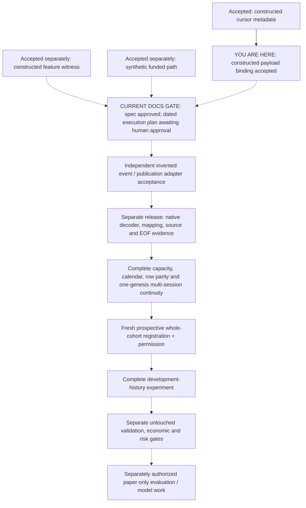

This is a development-gate map, not a live execution/data-flow diagram. Native evidence, historical capacity and continuity may need separate small contracts; the grouped node does not authorize one large implementation. Live orders remain outside this roadmap.

## Current specification gate, not an implementation release

The direct14:41:15UTCrenewal initially authorized **closing a complete typed adapter specification only**. [The unchanged contract](docs/6E_TYPED_NATIVE_EVENT_ADAPTER_CONTRACT_20261011.md) specifies declared native-shaped v3/AS_IS/`ts_out` context, all target and foreign records, original order/initialization, target-free events/37-feature publications, caps and metadata-before-values refusal. The human later approved this specification and explicitly requested offline planning/task-list preparation; its PROPOSED wording is retained earlier chronology, not a current missing contract approval. It uses invented fixtures, with actual native decoding and historical-source reads excluded. Placement is resolved in favor of new dated files; the saved execution plan/task list must now be presented for direct approval. No new source work is released, and a future implementation needs its own explicit scope/window.

Acceptance must distinguish decoded position from successful-book ordinal and byte offset; retain foreign records without driving target timers; preserve original equal-time publication and reset behavior; and keep complete native event provenance separate from the protected execution-capture suffix. Do not coerce a mapped instrument, native genesis or historical window into the old target-only witness.

Later gates remain complete-session capacity, dated mapping/calendar support, original feature-row parity and one-genesis continuity across sessions. Before any historical experiment, independently review its implementation and prospectively freeze the **whole** cohort, sources, roles, assumptions, resources and failure behavior. Already exposed history is development data, not untouched validation. Quote-only timestamp/bid/ask rows cannot prove CVD/depth/replenishment/absorption features. Broker fill/fee/margin evidence remains separate.

Design references: [decoded-payload next gate](docs/6E_DECODED_PAYLOAD_NEXT_GATE_20261011.md), [native cursor/publication bridge](docs/6E_NATIVE_CURSOR_BRIDGE_NEXT_GATE_20261010.md), [historical bridge](docs/6E_HISTORICAL_BRIDGE_NEXT_GATE_20261010.md). These do not release code, native/history access, training, scoring or promotion.

## Plans and stop boundary

[The approved payload plan](tasks/plan.md) and [task list](tasks/todo.md) are implementation-complete. Their RED/GREEN, dispatch and original15:57:08closure procedures are retained history, not pending implementation instructions; the later direct documentation-only renewal supersedes that stop time. Two unchecked historical closure items remain, unchanged. The human explicitly chose new dated files, so [typed adapter plan](tasks/typed_native_event_adapter_plan_20261011.md) and [typed adapter tasks](tasks/typed_native_event_adapter_todo_20261011.md) are separate; the defaults are not overwritten, renamed, appended or bulk-closed. The new plan has thirteen ordered tasks, five implementation checkpoints and coverage of all fifteen contract groups; all runtime verification remains prospective. No further Python edits, tests, imports, examples, simulations, native/model/training calls or new increment are released in the current [documentation window](docs/6E_TYPED_NATIVE_EVENT_ADAPTER_WINDOW_20261011.md).

The current directly renewed hard stop is **2026-10-11T18:41:15Z (19:41:15 Lisbon)**. No launch, automatic extension or next-day continuation follows. The heartbeat is deleted at that deadline. A future task needs its own direct scope/approval; the workflow in [AGENTS.md](AGENTS.md) makes specifications, plans, independent tests/reviews, frozen complete acceptance and honest handoffs explicit.

Every 6E authentication/account/funding/receipt/cash/margin/risk/storage/resume/execution/trading/training/scoring/validation/promotion authority remains false. Preserve UNKNOWN liabilities and all old source/target/input/result/control pins. No late fill, UNKNOWN cancellation/reconciliation, reseeding, daily reset, successful-subset scoring, old-fill filtering or future terminal-plan stitching. Disabling App Security is not an established fix; it was not inspected or changed.
