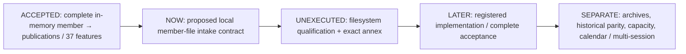

# Proposed local member-file intake witness contract — 2026-10-14

## 1. Status, purpose and scope

**PROPOSED / UNIMPLEMENTED.** This is the next single-capability specification under the [four-hour documentation window](6E_LOCAL_MEMBER_INTAKE_WINDOW_20261014.md), ending **2026-10-14T16:09:49Z**. All acceptance groups and filesystem proof gates below are **UNEXECUTED**. Saving or statically accepting this document does not qualify a filesystem mechanism or release code, plans, tests, native execution, historical inputs or a new deadline. The standing routine-approval waiver avoids repeated approval questions, not evidence or scope requirements.

Goal: connect one prospectively registered, invented, local regular member file to the already accepted in-memory member/publication bridge through **one complete immutable byte capture**. The consumer receives the complete capture, complete bridge evidence and a distinct observation receipt. The claim is bounded file-to-byte-to-bridge consistency within a separately qualified local profile—not vendor provenance, historical authenticity, immutable storage or authorization to trade.

Assumptions surfaced for this bounded design:

- One leaf directly below one registered local root; no directory search or nested relative traversal.
- First implementation profile would target the existing Windows environment and only a separately qualified local filesystem. Windows/NTFS is a candidate, **not an observed or qualified property of this machine**.
- Only future newly constructed fixtures in an explicitly registered non-protected fixture root. Existing raw/history/reserved/archive/oldpacket inputs remain excluded, even if small enough.
- Existing bridge inputs, labels, caps, native containment and public signatures remain unchanged. A local filename is never substituted for the bridge's invented fixture/session identifiers.
- No source write, extraction, rename, delete, cleanup, cache, registration writer, CLI or automatic retry belongs to the proposed library.

A plain file reader would be shorter, but would not close the relevant check/use, complete-read and attempt-evidence questions. This contract therefore fixes the required semantics and leaves OS-dependent representations/mechanisms behind explicit proof gates. It must not be described as implementation-ready until those gates and the exact annex close.

## 2. Position in the research track



This is one acquisition capability with an unchanged downstream consumer, not a new archive subsystem. Archive discovery/extraction, acquisition from vendors or network sources, historical row parity, source-bound historical publications, full historical capacity/calendar and one-genesis multi-session accounts/economics/untouched validation remain separate later gates. The BTC Spot roadmap and cloud collectors are unaffected.

## 3. Existing behavior that must remain unchanged

The [bridge guide](6E_SOURCE_PUBLICATION_BRIDGE.md), [held bridge contract](6E_SOURCE_PUBLICATION_BRIDGE_CONTRACT_20261013.md), [literal protocol](6E_SOURCE_PUBLICATION_BRIDGE_PROTOCOL_20261014.json) and [public source](../src/ai_trader/research/six_e_source_publication_bridge.py) control the accepted component:

- Its preflight accepts exact built-in `bytes`, length1–262,144, and compares the complete raw SHA256. It has no caller-path intake API.
- `BridgeContext` retains `fixture_id`, `source_session` and the fixed native context. Do not coerce the instrument, daily initialization, genesis, clocks or session window to fit another file.
- Positive `bridge.replay` and `bridge.verify` each make exactly one contained public native operation and at most two pure adapter reconstructions. Never implement intake verification as replay followed by verify.
- Every target/foreign raw occurrence, wire order, framing, metadata, book/event/quote/37-feature result, publication link and terminal state stays complete. The intersection of all existing caps remains independently enforced.
- Existing causal links exclude future complete-member/frame/EOF totals and unconsumed suffix. New file paths, identities, registration, read history or timestamps must not enter those hashes.
- Existing native-child containment does not contain parent filesystem opening/reading or bridge processing. The new layer cannot inherit a hard I/O deadline by citing the child limits.
- Existing provider and adapter verification phases remain local. A new outer metadata-first promise must not be stated as global deep-body preflight.

The old protected dataset and historical archive modules are not adopted as qualified secure readers. Their existence is not qualification evidence for this new boundary; importing them would also broaden the dependency and data scope.

Held runtime acceptance remains **15,037passed + exactly3expected skips**, all15,040case-sensitive identities, complete245receipts/bodies and pins reconciled at11:58:03Z. [Full acceptance](../logs/source_publication_bridge_20261014_1/full_1_acceptance.json). No repeated runtime check is required to write this specification.

## 4. Trust model and abuse cases

| Boundary / asset | Threat | Required proposed disposition |
| --- | --- | --- |
| Run registration → requested root/leaf | Caller presents a self-authored marker or hash as ownership | Registration comes from the future explicitly scoped fixture run; a digest/marker alone is not authenticated authority |
| Path → opened object | Traversal, alternate namespace, reparse ancestor, path substitution | Reject unsupported grammar; qualify the entire acquisition path before any content read; lexical containment alone is insufficient |
| Opened object → captured bytes | Hard-link alias, writer/mapping, growth, truncation, short read or same-size replacement | Same admitted object, fixed complete-read policy, expected complete bytes, explicit pre/post observations and finite adversarial qualification |
| Capture → bridge | Submitted data replaces original bytes; extra native invocation | Pass the exact immutable captured bytes once to unchanged public replay; verification uses separately supplied original captured bytes once through public verify |
| Evidence → later consumer | Receipt is mistaken for immutable source, authentication or current file state | Separate complete content identity from observation attempt; explicitly limit verification to consistency |
| Open/read/close → resource limits | Blocking I/O, leaked handles, failed cancellation or output blow-up | New qualified containment/cleanup before a positive capture API; existing child limits are not a substitute |
| Names/diagnostics → logs | Unnecessary private path exposure | Registration-scoped paths in complete receipt only; no secrets, arbitrary file contents or external telemetry |

The operating system is part of the observation mechanism, not an authenticated vendor. Administrator/kernel compromise, hostile drivers and coherent replacement of all caller context/evidence are not detected by this contract. Equal timestamps/file IDs and a successful hash comparison do not prove that bytes were never modified or that the path has never had aliases. Observation does not establish legal ownership, licensing or market-data provenance.

## 5. Proposed public surface and representations

These names and logical fields are **proposed**, not installed APIs. The exact typed OS observation/receipt schemas, constants, enum domains, result/error representations and profile digest must be closed in a separately reviewed annex after G1–G4. No placeholder, arbitrary dictionary or permissive extra-field fallback may stand in for that annex.

```python
def protocol() -> dict: ...
def protocol_sha256() -> str: ...
def request_sha256(request, context, *, expected_protocol_sha256) -> str: ...

def acquire(
    request, context, *,
    expected_protocol_sha256, expected_request_sha256,
    expected_member_sha256, expected_metadata_sha256,
): ...  # -> IntakeEvidence, only after complete capture/cleanup/bridge success

def verify_capture(
    evidence, original_member_bytes, request, context, *,
    expected_protocol_sha256, expected_request_sha256,
    expected_member_sha256, expected_metadata_sha256,
    expected_evidence_sha256,
) -> None: ...
```

The first three APIs are pure with respect to caller-file access and native execution; reading fixed package protocol resources is not caller-file intake. `request_sha256` validates the complete request/context, not just a pathname. `acquire` is the only proposed API permitted to acquire a member file. `verify_capture` **never opens the original path**. It verifies complete supplied capture/receipt/bridge consistency and returns `None`; it does not prove the prior file observation occurred or that the file still exists or matches now. A new `acquire` is a new attempt, not verification of a historical attempt.

Logical frozen/slotted records to be specified exactly:

| Record | Required logical fields |
| --- | --- |
| `FileIdentity` | Exact registered volume identifier and full file identifier representation; native conversion/domain fixed by G1, not guessed from Python `stat` |
| `FileRequest` | `registration_sha256`, `root_path`, `member_name`, `expected_size`, `expected_root_identity`, `expected_file_identity` |
| `IntakeContext` | `filesystem_profile_sha256`, unchanged complete `bridge_context` |
| `CapturedMember` | `byte_length`, `member_sha256`, complete lowercase `member_hex` |
| `ContentBinding` | Status/version, bridge protocol/context identity, complete member length/hash, complete bridge evidence identity, own digest |
| `CaptureReceipt` | Exact request/context and their identity, qualified filesystem profile identity, complete ordered root/ancestor/file observations, complete acquisition ledger/EOF/cleanup and own digest |
| `IntakeEvidence` | Status, protocol/request identities, complete request/context, `CapturedMember`, complete unchanged `BridgeEvidence`, `ContentBinding`, complete `CaptureReceipt`, ordered authority tuple and own digest |

No defaults, optional “unknown means accept”, subclass coercion, path-like callbacks, user file objects, arbitrary handle inputs, streaming generators or caller-selected implementation/codec are supported. Exact built-in integers exclude booleans; exact strings are not normalized into different identities. Record projection follows explicit literal field lists, not reflection. All nested logical fields above must receive exact types and bounds in the annex before implementation.

Expected pins are exact lowercase64-hex strings. Protocol and filesystem-profile pins must match registered fixed complete bodies; unknown or unclosed profiles refuse before I/O. An unknown digest is not permission to accept an arbitrary profile. Expected member length/hash are fixed **before** acquisition; do not read first and retroactively register the observed hash. Registration's expected content comes from independent complete invented byte oracles, never production encoding/decoding or a previous uncontrolled path read.

The **externally trusted expected_request_sha256** is the admission binding for the complete exact FileRequest + IntakeContext, including root/leaf/expected identities/size/profile/bridge context. The future root-owned registration fixes that expected pin and the expected member/metadata pins before launch. The library compares all corresponding complete values; it does not accept a newly computed request pin as proof of authorization. FileRequest.registration_sha256 is an opaque retained reference to that external registration, not an authenticated body or a library-validated allowlist. There is no implicit registry loader/lookup or ownership-marker reader. If an untrusted caller controls both the request and every expected pin, this interface provides consistency only and cannot enforce that caller's authorization; future execution must supply the expected pins from the prospectively scoped trusted registration. No closed-registration validation claim is made by the library.

## 6. Proposed path and object admission

Proposed lexical subset: one absolute DOS drive path for the registered root, with at least one directory component below the volume root, followed by **one leaf** supplied separately. Root and composed path each have at most240ASCII characters. Root components match `[A-Za-z0-9_-]{1,64}`; the leaf matches `[A-Za-z0-9_-]{1,64}\.dbn\.zst`. Reserved device basenames refuse case-insensitively even if followed by the allowed suffix. The suffix is a name constraint, never proof of content format.

Reject relative/drive-relative paths, UNC/network paths, user device/extended namespaces, separators in the leaf, colons/alternate streams, dot components, wildcards, NUL/control/non-ASCII characters, trailing dot/space and all unsupported aliases. Do not trim, lowercase, resolve an escape and then accept it, or silently expand the grammar. Exact supplied spelling is retained. Exact observed OS spelling/namespace is retained separately; a qualified comparison rule, not text replacement, relates the two.

The future trusted registration must identify one permitted non-protected root and leaf and bind their expected identities and complete expected request pin. Holding that expected pin fixed prevents a different request from expanding the registered scope; accepting attacker-supplied replacement pins would not. The registration digest is only an opaque consistency reference, not proof of authority or origin. The library does not create/read registration or inspect unrelated roots. No glob, recursive walk, alternate path, archive member selector, symlink resolution fallback, implicit download/hydration or discovery is permitted.

A positive acquisition requires, before reading content:

1. A qualified registered-root/ancestor mechanism covering substitutions during open—not only a leaf flag or earlier `resolve()` call.
2. Existing-only, read-only access and non-inherited handles; no create/truncate/write/delete/access-control or privilege change.
3. Same-object handle-derived final name, filesystem/type/attribute/link-count and root/file identity observations matching the exact profile and registration.
4. Rejection of directories, devices/pipes, reparse objects/ancestors, unsupported aliases, multiply linked files, network/unsupported filesystems and recall/placeholder/offline cases under the qualified profile. Missing or unavailable observations refuse.
5. A qualified strategy excluding competing write/delete accesses over capture, with explicit treatment of pre-existing mappings/handles and unsupported cases. “Sharing denied” is not an unqualified immutability theorem.
6. Root/ancestor and file handles held for the lifetime required by the qualified mechanism. No check-name/open-name gap may be hand-waved away.

The exact Windows mechanism and all query behavior are **G1/G2 blockers**. This contract deliberately does not prescribe an unproved combination of flags as a completed solution. If protection cannot be established without changing the accepted environment/security configuration, retain the blocker; do not bypass it.

## 7. Complete acquisition semantics

“Single acquisition” means one non-rewinding sequence from one admitted file object, not one OS read call. Proposed complete input bound remains1–262,144bytes. Empty and first-excess files refuse. Use the registered expected length, independently observed initial size and actual complete read total; all three must agree.

The proposed transport policy is finite and explicit: each sequential data-read request is exactly min(65,536, expected_size - total_data_bytes_read), always positive, with returned count required to be in 0..requested_count. Retain every requested offset/count and actual count/status; never seek/reopen/retry against another object. An impossible returned count refuses before accepting or accumulating that response. Permit positive short reads only while total length is below the expected length and a maximum128data-read calls is not exhausted. Zero before expected length is truncation/refusal. Data reads never consume beyond the expected data portion. After exactly the expected bytes, make exactly one bounded1-byte overflow/EOF probe on that same handle. It must establish the profile's qualified EOF result with zero extra data. A byte, ambiguous status, failure or inability to complete refuses. At most129read calls and262,145returned bytes for conforming read responses including a refused overflow sentinel; a malformed transport response cannot be reclassified as within those guarantees. The extra byte is never passed to the bridge or used to truncate an oversized input.

Keep complete ordered read results and raw block hashes in the receipt; offsets are contiguous, total data bytes equal the retained full capture, and per-block hashes independently match its exact slices. Do not persist partial successful-prefix evidence or return partial bytes. This ledger proves internal consistency, not that an untrusted caller's fabricated OS observations occurred.

Collect required same-handle post-read identity/metadata observations. Reject changed identity, admitted type/link/attributes, declared size or any profile-designated stability field. Do not require incidental access-time equality without a justified OS rule. Content SHA256 must match the predeclared complete member pin. Same-size mutation, concurrent write/mapping and metadata restoration must be in G2/G3 controls; matching pre/post metadata alone is insufficient.

Observe acquisition EOF separately from native compression/frame/DBN EOF, which remains a later unchanged bridge check. Close every owned file/root/ancestor handle, confirm cleanup and any exact owned worker exit **before** invoking the bridge. If closing/cleanup/containment is incomplete, no bridge dispatch and no positive capture evidence. A file may change after successful close; the evidence concerns captured bytes and the observation interval, not current or future file state.

The new library performs no output-file writes. Its returned immutable `bytes` equivalent is represented completely in `CapturedMember.member_hex`; no path reread is required by consumers. Full error/attempt diagnostics belong to future root-owned test evidence, not a partially successful public evidence object. Fixture creation/destruction is a later separately registered harness concern; never implement implicit cleanup that could delete an input.

## 8. Phases and composition

### Acquisition

1. Validate all new pin syntax, fixed protocol/closed-filesystem-profile identity and complete request/context metadata, including exact classes, limits, root/leaf spelling, opaque registration-reference syntax and expected byte count; compare the complete request/context identity to the externally registered expected request pin. Derive unchanged bridge context identity through its public API. No caller-file I/O, implicit registry lookup or native decoder yet.
2. Enter only the qualified G4 I/O containment mechanism; admit root/ancestors/file as in section6 before content reading. All requested root/file operations must be within the explicit registration. A valid path's syntax alone is not authority.
3. Acquire the complete bytes/ledger/post-observations and exact cleanup under section7. Validate actual full length/hash and complete receipt relations.
4. Pass the same captured exact `bytes` once to `bridge.replay` with the fixed bridge protocol and derived bridge context pins, original expected member pin and expected metadata pin. No private helper calls, parser bypass, duplicate native execution or retry.
5. Form content binding and full intake evidence. Apply every nested old cap plus new complete caps, all false flags and exact own-hash exclusions. Only then return positive evidence.

### Submitted verification

1. Validate new expected pins, original request/context and submitted outer record/status/profile/request identities/authority/ledger metadata before reading `original_member_bytes` content, `member_hex` or traversing the nested bridge evidence body. Explicitly project and compare the complete actual submitted request/context records, including those retained in the receipt, with the supplied original request/context; comparing their reported digest fields alone is insufficient. Require every actual new authority name/value in its fixed order and literalFalse form before deferred body traversal. This is a scoped outer guarantee, not a promise that all dependency internals are globally prevalidated.
2. Validate exact original `bytes` type/length, then complete original hash, retained full hex equality, ledger slice hashes and all request/observation/EOF/cleanup relationships. The claimed original capture is a supplied argument, not authenticated external evidence.
3. Invoke unchanged public `bridge.verify` **once** with the original bytes, unchanged bridge context, expected metadata/member/protocol pins and submitted nested bridge own pin. Do not first replay it; do not derive original bytes from submitted nested fields.
4. Reconstruct every content/receipt/envelope field and compare complete canonical bodies and own digests, with no omitted observations or changed terminal semantics. Return `None` only on full consistency.

Real uncaught deferred-access sentinels must test each new deferred field/family; broad catch-all swallowing would invalidate phase evidence. Expected validation/I/O/refusal outcomes use a documented consistent public exception strategy; exact categories/codes and OS detail mapping are annex work. Unexpected assertion/programming exceptions remain distinguishable. Diagnostic wording is not a native behavioral oracle.

## 9. Identity, canonicalization and capacities

Three non-interchangeable identities are required:

| Identity | Includes | Excludes |
| --- | --- | --- |
| Stable complete content binding | Fixed content version/status, unchanged bridge protocol/context pin, complete original member length/hash and bridge evidence own pin | Root/file identity, path, registration, read partition, attempt time/handle/process values |
| Complete intake attempt/envelope | Exact request/context, captured complete hex, full bridge evidence, content binding, every observation/read/EOF/cleanup/receipt field and all authority flags | Only its own named digest when deriving that digest |
| Existing causal publication links | Exactly the accepted bridge's consumed native/adapter prefix fields | Every new intake/attempt fact, whole-file completion and future suffix |

The content binding is portable across registered locations for identical member bytes and unchanged bridge context. The full envelope is not: observations may differ across attempts. Fresh capture must never compare attempt timestamps/handles as though determinism were required. Conversely, verification of a supplied complete receipt must not drop volatile observations merely to obtain equality; they remain part of that submitted attempt's complete identity. Replaying a coherent forged receipt still does not authenticate it.

Proposed new canonical rules: UTF-8 JSON, sorted keys, compact comma/colon separators, ASCII escaping, no NaN/Infinity, ordered tuples projected to lists, exact fixed keys, lowercase hex. No floating-point OS representations. Nested bridge numeric values and projection semantics remain exactly the existing schema, including finite floats where that schema allows them; do not coerce them to integer/text. Hash complete bodies using SHA256 with only the record's named own-digest excluded. Complete full-artifact caps include own digests.

Proposed new independent caps:

| Object | Maximum |
| --- | --- |
| Pure request + context canonical body |65,536bytes |
| New fixed protocol / closed filesystem-profile body |262,144bytes each |
| Complete capture receipt body and full receipt |262,144bytes each |
| Complete content-binding body and full binding |65,536bytes each |
| Whole intake evidence body and full evidence |8,388,608bytes each |
| Captured member |262,144bytes, complete hex at most524,288characters |
| Root+ancestor observations / read calls |32objects total /128data calls +1EOF probe |

All are proposed constructed limits, not measured historical capacity. Equality passes and first excess refuses; no omission, truncation, thinning, splitting, summary-only receipt or cap override. Every old bridge/native/adapter/binding/cursor cap remains independent. An outer8MiB cap cannot enlarge old4MiB/1MiB/262KiB/65KiB limits. New parent/I/O resource policy is G4, not implied by serialization caps.

## 10. Authority policy

The proposed outer authority tuple has exactly the existing bridge's28names, in that order, each exact literal `False`: source, collection receipt, native runtime/ABI/wire/header/EOF, feed, calendar authentication; historical read/validation; book/event/feature acceptance; account, funding, receipt, cash, margin, risk, storage, resume, execution, trading, training, scoring, independent validation and promotion. Exact spellings come from the held literal bridge protocol, copied literally into the future annex, not generated from runtime reflection.

All28nested bridge/native,34adapter,31binding and26cursor authorities remain false. Reading a specially authorized invented fixture in a later registered experiment is not represented as general historical-read/storage/receipt authority. Descriptive observation status is not an authority bit. Do not introduce a `source_authenticated=True` or equivalent “trusted file” shortcut.

## 11. Blocking filesystem qualification gates

All four gates are **UNEXECUTED**. They are technical evidence prerequisites, not requests to repeat routine approval. No positive profile, capture implementation release or claimed protection may be emitted with an open gate.

| Gate | Required closure evidence |
| --- | --- |
| G1 — exact platform representation | Official API/structure/flag/query reference selectors; exact fixed Windows/runtime/filesystem support profile; field types/domains/absence/error distinctions; raw-vs-normalized name conventions; no guessed numeric constants or ABI layouts |
| G2 — object admission and races | One explicit root/ancestor/leaf mechanism; registration authority boundary; reparse/alias/hard-link/network/placeholder policy; authoritative reasoning plus independent finite substitution/mapping/sharing controls proving supported refusals/prevention before content reads |
| G3 — acquisition completeness | Independent literal full bytes and per-read expected ledgers; short-read/EOF/overflow/growth/truncation/same-size mutation controls, pre/post facts, no reopen/seek/fallback, complete cleanup evidence |
| G4 — resource and lifecycle | Independently registered open/read/close/cleanup containment including initialization, blocking operations, interruption, output and owned-process identity; exact limits before execution; harmless controls before any native bridge composition; no inherited proof from the old native worker |

G4 must choose and prove an architecture; no hard deadline is claimed for synchronous parent I/O. A candidate dedicated intake worker must have its own process-birth containment/transport/identity/cleanup proof, not borrow another worker's receipts. If an in-process approach is proposed instead, the contract needs an explicit reviewed change to its resource promises; a timeout checked after a blocking call is insufficient.

A reviewed closed annex must resolve all exact schemas/error policies/protocol bytes, positive/negative fixture declarations, lower-level API behavior and limits before a provider implementation plan. Mandatory race/link controls cannot silently become optional skips because local privileges are unavailable. Missing prerequisites leave qualification incomplete; do not change Windows/security settings to make them pass.

## 12. Proposed acceptance groups — all UNEXECUTED

| Group | Complete required evidence |
| --- | --- |
| L1 protocol and registration | Complete independent literal protocol/closed-profile/request bodies, fixed pins, unknown/malformed/subclass/missing/extra-field refusal; all new external reads absent before valid metadata |
| L2 names and scope | Entire grammar, reserved case variants, traversal, streams, UNC/devices/aliases; non-protected registered root/leaf only; no discovery or normalization-based widening |
| L3 admitted object | Correct/wrong volume/root/file IDs; unsupported kind, reparse, hard-link, network/recall objects; exact identity/attribute/query failures; no content access before admission |
| L4 substitution and mutation | Root/ancestor/leaf swap at every relevant seam, writer/mapping and same-size-change controls; exact prevention/refusal and observed bounds, not just a filename inequality |
| L5 complete read and EOF |1byte/cap/cap+1, empty, size disagreement, short reads,128/129data-call boundary, earlyEOF/growth, distinct overflow probe and nativeEOF, full literal bytes and ledger slice hashes |
| L6 resources and cleanup | Qualified limits from birth/initialization through open/read/close, cancellation/timeout/close failure, all handles/owned workers accounted for; no partial positive result or implicit input deletion |
| L7 bridge dispatch | Same captured exact bytes, one public replay; one public verify without preceding replay; exact arguments/returns/errors and no private production seam/retry |
| L8 complete nested semantics | Full independent raw target/foreign/header/metadata/native framing and book/event/quote/37-feature/publication/terminal bodies; all prior cap/intersection/refusal behavior unchanged |
| L9 receipt and envelope tampering | Every actual original/submitted observation/read/EOF/cleanup/body/pin field exercised; full canonical comparison and all own-digest exclusions, not summary-only or production-derived expected bodies |
| L10 scoped phase order | Real uncaught sentinels for each deferred body/family; malformed outer metadata/flags/pins refuses before I/O/body traversal; dependency-local phases not misrepresented |
| L11 identity separation | Same bytes/context across two registered paths preserve content and old causal identities while attempt evidence changes; no volatile-field omission in verification of one receipt |
| L12 future exclusion | Changed valid suffix alters complete identities, not earlier valid publication prefixes; file path/root/registration/completion/EOF never leaks into causal seed or link |
| L13 caps and representations | Each old/new limit at/either side, exact native integer/text/null/absence shapes, finite nested floats and full hex retained; no truncation/splitting/coercion |
| L14 negative authority | Exact28outer and all nested false flags; no provenance, historical/account/model/trading permission or current-file-state claim; coherent full replacement limitation explicit |
| L15 complete acceptance | Genuine executed missing-behavior RED/GREEN, actual seam mutants/exact restoration, independent complete reviews, full focused/adjacent/old+new case-sensitive suite/skipXML/receipts/bodies/pins/owned exits; no omitted old cases or expired-deadline bypass |

Fixtures/oracles must be authored independently of production serializers/dataclass reflection/native self-roundtrips. Any receipt observer is test-only, prospectively registered and must preserve exact original arguments/return/errors/cleanup/restoration without adding an invocation. No new count is guessed. Preserve intentionalGZIP/gzip identities and historical failed attempts. Accepted code stays frozen during every future run; all future runtime is root-owned.

## 13. Structure, style and commands

Existing Python3.12/stdlib and unchanged public bridge are the intended logical stack; no new dependency is authorized. Exact filesystem worker/platform binding/support files depend on G1–G4 and are not silently fixed by this prose. Proposed new paths, presently absent:

- `src/ai_trader/research/six_e_local_member_intake.py` — public wrapper only.
- `tests/test_six_e_local_member_intake.py` — independent contract tests.
- Any OS boundary/support module, literal protocol resource or independent oracle file needs an explicit later reviewed file list; none is created here.

Follow current exact types, frozen/slotted records, explicit fixed-field projection and bounded error discipline. Illustrative style only, **not executed or an implementation**:

```python
@dataclass(frozen=True, slots=True)
class CapturedMember:
    byte_length: int
    member_sha256: str
    member_hex: str
```

Commands below are **UNEXECUTED future templates**, not today's instructions or run registration. Paths do not yet exist. They become runnable only after proof closure, separately released implementation, new prospective command/identity/expected-cohort registration and supported current qualification-test deadline. Log names must be unique per future run; never overwrite held reports.

```powershell
.venv/Scripts/python.exe -B -m pytest -q tests/test_six_e_local_member_intake.py --junitxml=logs/local_member_intake_focused_FUTURE.xml
.venv/Scripts/python.exe -B -m ruff check .
.venv/Scripts/python.exe -B -m ruff format --check src/ai_trader/research/six_e_local_member_intake.py tests/test_six_e_local_member_intake.py
.venv/Scripts/python.exe -B -m pytest -q tests scripts/test_native_profile_qualification_20261012_1.py -o junit_logging=all -o junit_log_passing_tests=true --junitxml=logs/local_member_intake_full_FUTURE.xml
```

Do not run these with the old13:33:18qualification deadline or change that accepted literal in this documentation window. Future full acceptance retains every15,040old identity and exact old skip XML plus exactly all independently accepted new identities, complete receipts/native/file-I/O bodies/limits/cleanup/owned exits and unchanged held pins. A test report's dots or process absence alone is never sufficient.

## 14. Reference basis and limits

The following official pages were consulted for design constraints, not executed as qualification. Their web revisions are not immutable implementation pins; G1 must preserve exact authoritative selectors/content identities and reconcile the actual supported runtime before implementation.

- [Microsoft CreateFileW](https://learn.microsoft.com/en-us/windows/win32/api/fileapi/nf-fileapi-createfilew): existing-only disposition, sharing compatibility, handle inheritance and reparse-opening flags are relevant controls. This contract does not infer complete ancestry protection from them.
- [Microsoft GetFinalPathNameByHandleW](https://learn.microsoft.com/en-us/windows/win32/api/fileapi/nf-fileapi-getfinalpathnamebyhandlew): final-name retrieval is handle-based with explicit representation/size/error behavior; it is an observation, not source provenance.
- [Microsoft FILE_ID_INFO](https://learn.microsoft.com/en-us/windows/win32/api/winbase/ns-winbase-file_id_info): volume/file identity fields support comparison of opened objects; they are not a cross-machine or everlasting authenticity certificate.
- [Microsoft reparse points and file operations](https://learn.microsoft.com/en-us/windows/win32/fileio/reparse-points-and-file-operations): reparse/filter behavior needs explicit handling; unexamined filesystem behavior cannot be called safe.

The security skill's ownership-marker and check/use warnings are reflected in G2. API/interface guidance keeps the new acquisition boundary distinct from existing pure bytes/causal semantics. Documentation guidance retains rejected alternatives and unresolved proof gates instead of polishing uncertainty into guarantees. No dependency audit, security scan, Windows setting change or native probe was run; this is a documentation-only design, not a software release.

## 15. Alternatives and completion definition

Rejected for this scope:

- **Path check followed by ordinary reopen/read:** insufficient to establish same-object/root traversal guarantees.
- **Archive extraction or recursive file search:** independently testable, much larger capability with different attack/data scope.
- **Reopen during verify:** observes a new attempt rather than verifying the historical capture.
- **Hash only / marker only:** loses complete receipt/body evidence and does not authenticate ownership.
- **Force a large file into existing caps:** changes the question through truncation/thinning/splitting; refuse instead.
- **Treat worker limits as parent I/O containment:** confuses distinct process/resource boundaries.
- **Retrofit old accepted readers or bridge:** breaks held evidence and unnecessarily broadens this increment.

Documentation completion requires source-grounded claims, explicit proposed status, independent static review closure, working local links and accepted-code preservation. It is not G1–G4 qualification, L1–L15 acceptance, a closed filesystem profile or an implemented provider. Unresolved issues are technical proof and exact-representation work, not another request for routine permission. After presenting the saved proposal, stop before execution planning/tasks/code. The current16:09:49Zhard end remains unchanged.
