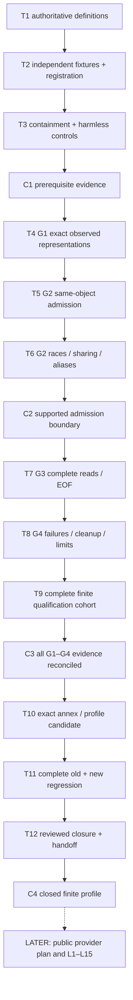

# Local member intake G1–G4 proof plan — 2026-10-14

## Planning review and current progress

Two independent complete static reviews accepted this new plan/task list with no Required finding. The optional observer wording was clarified to retain cleanup. [Official reference packet](../docs/6E_LOCAL_MEMBER_INTAKE_REFERENCE_PACKET_20261014.md) advances T1 to **PARTIAL**, with thirteen immutable official documentation body pins. Complete ABI/schema/mechanism definitions remain unresolved; T1 stays unchecked, every runtime proof/checkpoint and all L1–L15 remain UNEXECUTED. The next prerequisite is technical preparation, not human approval.

## Current authority and deliverable

The human repeated standing permission and then directly requested `continue`; root checked UTC **2026-10-14T14:51:41Z**. This advances the next documentation step: a concrete proof plan and [dated task list](local_member_intake_g1_g4_todo_20261014.md). Routine approval pauses in skills and older handoffs are superseded for this step. No further routine approval is pending. The existing [window](../docs/6E_LOCAL_MEMBER_INTAKE_WINDOW_20261014.md) still ends **2026-10-14T16:09:49Z /17:09:49 Lisbon**.

**Planning documentation; every runtime proof and checkpoint below is UNEXECUTED, T1 documentation is PARTIAL.** The [saved contract](../docs/6E_LOCAL_MEMBER_INTAKE_CONTRACT_20261014.md) remains unchanged at SHA256 `110921a0c338080f6da0498e8a2cb308cdd7ba85e1af4a82a9a85b8623c6efd9`. This plan closes the ambiguity about how to obtain evidence; it does not supply that evidence. G1–G4, the exact OS/profile annex and all L1–L15 provider acceptance groups remain open. This turn creates no qualification harness, fixture, oracle, provider or test code and performs no filesystem/native experiment. Later execution needs an explicitly scoped registration and credible runtime budget; the remaining documentation time is not that budget.

Use the two new dated files above. Preserve `tasks/plan.md`, `tasks/todo.md`, every earlier component plan/task list and all dirty/untracked work. The planning and documentation skills supply task sizing, dependencies, checkpoints and the standing Definition of Done; the user's established dated-file convention overrides default filenames.

## Objective and finish line

Qualify one narrow Windows/filesystem profile for complete acquisition of one independently invented regular member file beneath one registered root. Close exact representations, same-object/root admission, complete reads/EOF and resource/lifecycle containment. Then publish a reviewed annex and complete qualification receipt that justify a **later** public intake provider plan. The proposed five public APIs stay those in contract section5. Public provider implementation and its L1–L15 acceptance are a separate increment after the profile closes.

No OS version, filesystem, flag, structure layout, privilege availability or containment mechanism is assumed to be qualified on this machine. T1 obtains authoritative definitions; T4 observes the registered environment under containment. If a mandatory property cannot be established, retain the specific gate as open. Unsupported filesystem/race/resource cases cannot be converted into passing skips or relaxed metadata comparisons.

The existing bridge acceptance remains complete: **15,037passed + exactly3expected old skips**, all15,040case-sensitive identities and complete245receipts/bodies/pins accepted at11:58:03Z. [Acceptance receipt](../logs/source_publication_bridge_20261014_1/full_1_acceptance.json). The [12:25 documentation snapshot](../logs/local_member_intake_documentation_preservation_20261014_1.json) is historical preservation evidence. No old session, process, native body, test or component review is reopened for reassurance.

## Fixed constraints carried into the future registration

- All441registered Python files in src/tests/scripts, accepted resources/native artifacts/contracts/plans and old source/target/input/result/control pins remain held. The qualification-test literal stays **2026-10-14T13:33:18Z** in this documentation turn. Later regression must have supported prospectively registered deadline handling; no backdating, omission of old cases or disabling expiry.
- Only newly constructed complete fixtures in one explicitly named non-protected root may be created/read by a future registered harness. Root/leaf/identities/size/profile/bridge context and independent complete member/metadata pins must be fixed before acquisition. The external expected request pin supplies the admission binding; `registration_sha256` remains an opaque reference, not a registry lookup or ownership claim.
- Existing bridge/provider/adapter/binding/cursor public interfaces, caps, raw target/foreign bodies, metadata, book/event/37-feature/publication/terminal semantics and local verification phases stay unchanged. Use public APIs only in a later bridge composition. A test observer must preserve one original invocation, arguments, result/errors, cleanup and restoration.
- One capture uses the same admitted object without seek/reopen/retry/fallback. Data requests equal `min(65536, remaining)`; actual count must be0..requested. At most128data calls and exactly one1-byte EOF probe; at most262,145returned bytes for conforming responses. A malformed count is a refusal, not a bounded valid response.
- Complete captured member1..262,144bytes, full lowercase hex, exact contiguous read ledger/slice hashes, pre/post observations and cleanup remain retained. Root+ancestor observations are capped at32objects. Request/context65,536bytes; protocol/profile262,144each; receipt body/full262,144each; binding body/full65,536each; whole evidence body/full8,388,608each. Every old nested cap is independently enforced.
- All28outer/bridge/native,34adapter,31binding and26cursor authority flags remain literalFalse. File identity, hashes and receipts establish only bounded consistency. Coherent replacement of the entire caller context/evidence is unauthenticated and undetectable.

No archive/history/reserved inputs, old packets, market-data access, accounts/brokers/orders, models/training, dependencies, Windows/security changes, staging/commits or unrelated cleanup enter this plan. BTC/cloud/Graphify and UNKNOWN liabilities remain untouched.

## Dependency order

G4 has a prerequisite and a final closure. **Process and transport containment must be established before the first relevant file/API experiment**, including initialization. Complete G4 closure later includes actual open/read/close/cancellation outcomes. G1 has authoritative definitions before experiments and observed representation closure afterward. This avoids requiring empirical closure before the experiment that supplies it, or using an unqualified public provider to qualify itself.

The sequential spine is mandatory. Independent literal fixture/oracle authoring and reference extraction can run in parallel after common schemas are defined; harness authors cannot generate their own expected observations from production serializers. Read-only reviewers can inspect stable files while root prepares registration. Every writer holds during each launch; all old/new source, tests, resources and registration inputs freeze throughout a complete suite.

## Ordered task index

Full acceptance criteria, verification, dependencies, files and scope are in the [task list](local_member_intake_g1_g4_todo_20261014.md).

| Task | Deliverable | Main gate |
| --- | --- | --- |
| T1 | Official reference packet and exact unresolved representation list | G1 definitions |
| T2 | Independent complete declarations, future file list and prospective registration | G1–G4 prerequisites |
| T3 | Candidate containment architecture and harmless lifecycle/transport controls | G4 prerequisite |
| T4 | Exact observed platform/API/type/name/error projections | G1 |
| T5 | Registered-root/ancestor/leaf admission mechanism | G2 admission |
| T6 | Every declared substitution, alias, sharing and mapping control | G2 adverse cases |
| T7 | Complete independent acquisition/EOF ledger controls | G3 |
| T8 | Blocking/failure/cancellation/resource/close and owned-exit controls | G4 final |
| T9 | Complete finite proof cohort, no dropped cases or summaries | G1–G4 reconciliation |
| T10 | Exact schema/protocol/profile candidate and independent audits | Reviewed annex |
| T11 | Full registered qualification and old+new regression acceptance | Regression |
| T12 | Published closed profile/receipt and current documentation | Final closure |

Four checkpoints follow T3,T6,T9,T12. Each uses independently reconciled evidence, not another human permission pause. No task is checked solely because a document was saved or a subset passed. T6 qualifies pre-read admission/race/sharing properties; mutations during or after actual reads are exercised with T7 and reconciled in T9. C2 therefore freezes the supported admission mechanism, not all empirical G2/G3 closure.

## Experiment and ownership design to resolve in T2/T3

Root alone owns launches, exact deadline enforcement, receipt reconciliation and eventual fixture cleanup. Separate authors own the new proof harness/platform support and independent tests/oracles. A third reviewer reads stable files only. An explicit reviewed future file list must precede any new code: candidate artifacts are a qualification harness, intake worker/platform adapter, harmless controls, independent byte/read-ledger declarations and qualification tests, all under fresh dated paths. None exists by virtue of this plan. The absent public paths `src/ai_trader/research/six_e_local_member_intake.py` and `tests/test_six_e_local_member_intake.py` remain outside this proof increment.

The future registration must contain complete reference bodies/selectors, exact runtime/profile expectations, original and intended file sets/hashes, complete literal fixture bytes, exact root/leaf names and expected identities, independent oracles for every semantic outcome, resource/transport limits, command/environment, report paths, complete case identities and owned command/executable/creation/parent identity capture. Expected filesystem identities created during fixture setup may be observed at that **registered setup phase**, independently compared/pinned, and then locked before acquisition; expected complete bytes must already come from literal oracles. Setup observations are not retroactive content registration. Register race schedules and controlled mutator ownership as separate inputs.

Choose a mechanism that proves root/ancestor protection across opening and retains needed handles throughout capture. An earlier path check plus a name reopen is insufficient. A dedicated contained I/O worker is a candidate; its process-birth limits, initialization, transfer of the trusted registration, API handle inheritance, output transport, interruption and exact owned cleanup need independent controls. Existing native workers remain a later downstream boundary. In-process blocking calls require a reviewed change if they cannot meet the contract's containment promises.

Fixture creation/deletion, link/mapping/mutator operations and blocking controls are future harness capabilities with exact named targets. Cleanup must verify ownership and resolved paths, retain failures, preserve unrelated files and never delete the member implicitly through the public library. No protected data or arbitrary all-PC search is needed.

## Coverage map: proof closure versus later provider acceptance

| Contract group | Proof evidence prepared by | Later public provider evidence still required |
| --- | --- | --- |
| L1 protocol/registration | T1,T2,T10 exact schemas/external pin boundary | Public pure APIs and early rejection of malformed/unknown metadata |
| L2 names/scope | T2,T5,T6 grammar/namespace/alias controls | Public admission enforces every case before data access |
| L3 admitted object | T4,T5 exact IDs/type/query outcomes | Complete original/submitted object observations and public refusals |
| L4 substitution/mutation | T6,T7 schedules/sharing/mapping/full bytes | Public capture preserves the qualified mechanism at every seam |
| L5 complete read/EOF | T2,T7 literal transcripts and actual I/O | Public ledger/hex equality,128data+1probe boundaries |
| L6 resources/cleanup | T3,T8 independent containment/outcomes | Public failure/cleanup propagation and no partial result |
| L7 bridge dispatch | T2,T10 future observer schema/association | Actual one replay or one verify with exact capture and restored observer |
| L8 nested semantics | T2,T10 independent whole downstream bodies | Later composed unchanged raw/book/event/37-feature/publication/terminal evidence |
| L9 receipt/envelope tampering | T2,T9,T10 complete receipt schemas/oracles | Every original/submitted field family and complete canonical equality |
| L10 phase order | T2,T5,T7 lower-level access sentinels | Real uncaught public deferred-body sentinels, scoped early guarantees |
| L11 identity separation | T2,T9,T10 two-location complete identities | Same bytes/context preserve content/causal identities; attempt retains all facts |
| L12 future exclusion | T2,T10 unchanged causal field rules | Valid changed suffix/locations alter complete identity without prefix leaks |
| L13 caps/representations | T2,T4,T7,T8,T10 all exact limits/shapes | Each old/new public complete cap and full nested semantics |
| L14 false authority | T2,T10 literal authority packet/limits | Exact actual outer/nested literalFalse tuples and limited claims |
| L15 full acceptance | T3–T12 qualification RED/GREEN, mutants and full regressions | Separate public implementation RED/GREEN/reviews/focused/adjacent/full acceptance |

**G1–G4 closure does not mark L1–L15 completed.** Fake transport tests define the algorithm; actual registered object/I/O experiments qualify OS behavior. Neither replaces the other. Native output self-roundtrips, production serializers, dataclass reflection and summaries cannot supply independent byte/body oracles.

## Regression and complete evidence rules

Future complete acceptance must include every **15,040old case-sensitive identity** and exactly all accepted new proof identities, complete declared totals, zero failures/errors, exact three old skip identities and full XML reason representations. Preserve GZIP/gzip. Derive new counts from actual independently accepted tests; do not guess. Mandatory new filesystem/race/lifecycle cases cannot be skipped because local privileges are missing. Retain failed attempts and their full bodies.

The current accepted qualification deadline is expired by the time of this planning step. T2/T11 must resolve supported current-deadline registration and any narrowly reviewed test-harness amendment with a retained original snapshot before running future complete regression. Standing permission avoids another routine approval prompt; it does not permit backdating, bypasses or edits in this documentation turn. Old production and all other held files remain unchanged.

Reconcile complete wire/member/data/read/observation/EOF/cleanup/profile bodies, ownership of every mutator/worker, resource enforcement and exact exits as well as JUnit. Permit only explicitly registered non-semantic identity variance; observed handles/PIDs/times in an individual receipt remain complete. For a fresh attempt compare registered invariant projections, not volatile values as though they were deterministic. Compare the entire supplied receipt when verifying that same receipt. Publish no closed profile with an open required control or lifecycle outcome.

Future commands are chosen and pinned in T2; this document supplies no runnable launch. Use fresh unique output/report paths and a supported current deadline. Whole Ruff and new-file formatting, genuinely collected/executed intended RED/GREEN, exact new-file mutant restoration, complete independent reviews and final pin reconciliation remain required for future code. No suite or verifier is launched merely to verify this Markdown plan.

## Timing, risks and next actionable step

The current documentation deadline is fixed; no six-hour execution window is inferred. After static review, the immediate safe step is T1 **reference/schema preparation as documentation only**, if it has not already been completed. Source code, fixtures and all experiments await the separately registered proof increment. At16:09:49Z stop launches, summarize the documentation and remaining gates, delete the existing heartbeat and stop.

| Risk | Handling |
| --- | --- |
| Supported ancestry mechanism or mandatory race control cannot be proved | Keep G2 open; retain exact missing property; no fallback reader or privileged bypass |
| Blocking API cannot be stopped/contained | Keep G4 open; revise architecture before positive capture |
| Missing exact OS layout/error/absence behavior | Keep G1 open and annex candidate; authoritative definitions plus actual independent controls |
| Scripted read transcript mistaken for OS qualification | T7 requires both pure algorithm evidence and actual contained I/O controls |
| Ephemeral receipt facts omitted for determinism | Separate stable content from full attempt; retain all facts in receipt identity |
| Full suite cannot finish/reconcile before a future hard end | Do not launch late; preserve partial work and report incomplete acceptance |

Documentation completion needs closed static findings, working local links, preserved held files and an accurate current status. Proof completion needs every task criterion plus the standing Definition of Done and C4 evidence. Neither establishes source/history authentication, profitable strategy, model improvement or account/economic validation. Later archives, historical parity, complete capacity/calendar/one-genesis continuity and accounts remain separate gates.
