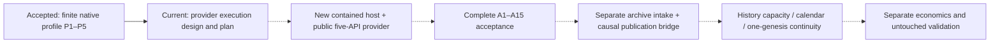

# Native-member provider execution plan — 2026-10-13

## Outcome and status

Continue the agreed next capability after the [closed finite P1–P5 profile](../docs/6E_NATIVE_PROFILE_CLOSURE_20261012.md): implement and accept the five bounded native-member witness APIs. The current deliverable is a reviewed plan and [contained execution design](../docs/6E_NATIVE_MEMBER_EXECUTION_DESIGN_20261013.md); provider implementation and A1–A15 execution are **not complete**. [Ordered task list](native_member_provider_todo_20261013.md) is the current work board. Earlier plans remain unchanged. Two independent complete static reviews found no required architectural/coverage issue; parser-bound and structural-versus-native emptiness precision edits are incorporated. This is planning acceptance only.

The user said continue on 2026-10-13 after stopping yesterday. Routine approvals remain waived. No new duration was requested; do not revive yesterday's heartbeat or invent a four/six-hour deadline. Progress through technical checkpoints without repeatedly asking for the same permission. A material scope change is not a routine checkpoint: history, account integration, dependencies and security changes remain excluded.

## Held inputs and precedence

1. [Original approved contract](../docs/6E_NATIVE_SOURCE_EVIDENCE_CONTRACT_20261012.md), SHA256 `290f11ae586e990885f63e84bd1b06c2fc083df83b3290b026b5c937e6792b35`.
2. [Exact schema annex](../docs/6E_NATIVE_PROFILE_SCHEMA_ANNEX_20261012.md), SHA256 `7a97af1f024fadf1e87fbafaf6acb5838d059ce2976bc9be07bc735dfc398d79`; its candidate chronology is superseded by actual closure, not silently edited. All 117 public schemas, 27 explicit records and 14-field Metadata control over older placeholders.
3. Closed profile body `5016b1dc56537fdefdac74e56154ceb410307f3677fb08d8455cba8f54c86b0d`; native RuntimeManifest `4aab559ab26a25cf35579dc723cb00d06db933ea65c63d9793a34939191c2ec3`.
4. [Accepted old full report](../logs/native_profile_20261012_1/full_1.xml): 12,417 case-sensitive unique identities, 12,414 passes plus exact three held skips; raw 12,528,530 bytes, SHA256 `e7638241e234784ce6a561bf4fbef96dfd956d891983a57fe46861061e3db847`. Contract A15's 12,206 is historical, not the new baseline.
5. [Registered old freeze](../logs/native_profile_20261012_1/final_python_freeze_1.json): all 428 Python files under src/tests/scripts held; canonical map SHA256 `ea97ad13f0cc254b10f377a68bdec4e00e31140e3ba9ca3241cac8a83693fa0e`. This is not an all-folder inventory. The old 227-file package fingerprint is `e82107504c0bce23a249bcba423e322c41b0367124d0c30f28327806b83f4b77`.

Do not rerun accepted suites, controls, examples or native qualification to establish status. A new provider baseline/freeze comparison and provider-focused checks are distinct new task evidence. Never use the old proof output itself as a new independent expected oracle.

## Boundaries and file ownership

The facade receives complete immutable invented bytes, complete typed Context and mandatory pins. No archive/file/URL/model/broker/history inputs, native caller objects, caller callbacks, source filters, transport coercion, new dependencies or Windows/security changes. All 28 authorities stay False. Coherent whole-context replacement remains unauthenticated and undetectable. No late fill, UNKNOWN reconciliation/cancellation, reseed, daily reset, subset scoring, old-fill filtering or future-terminal stitching. BTC/cloud collectors and Graphify stay untouched. No staging, commits or cleanup.

Proposed **new paths**, to be checked absent and registered before writing:

| Owner | Paths and responsibility |
| --- | --- |
| Source author | `src/ai_trader/research/six_e_native_member_decode_evidence.py`: public facade; `_native_member_types.py`: 27 explicit records and projections; `_native_member_engine.py`: independent framing/native worker computations; `_native_member_host.py`: fixed private Windows lifecycle/transport; `_native_member_worker.py`: fixed stdlib-first entry point |
| Root resource assembly | New adjacent `_native_member_protocol_v1.json`, `_native_member_profile_20261012.json`, `_native_member_execution_v1.json`; exact registration/trusted-anchor strategy closed in T1, no guessed digests or self-cycle |
| Independent test/oracle author | `tests/native_member_provider_oracles_20261013.py`, `tests/test_six_e_native_member_decode_evidence.py`, `tests/test_native_member_provider_host.py`; complete literal expectations and harmless controls, no production serializer/reflection defining expected truth |
| Root | New run registrations/reports/receipts under a fresh `logs/native_member_provider_20261013_N/`, dated docs/status updates and acceptance reconciliation |
| Reviewer | Read-only full stable-file review and targeted finding closures; never another writer on the same file |

These paths are a registration proposal, not a claim files exist. Small splits may be justified before writing and recorded explicitly; no accepted helper is edited or generalized. Production cannot import tests or the date-fixed proof executable. The source author derives production logic from the qualified reference/schema rules, retaining source attribution. All participants read relevant instructions themselves.

Root alone launches checks. Every writer holds stable files during **every** runtime check. Freeze all source/tests/resources/registrations through the final full suite. Independent reviewers inspect whole stable files and complete inputs, not only diffs. Assign distinct ownership; do not duplicate old P1–P5 review or spread mutable source across simultaneous authors.

## Ordered thin slices and checkpoints

| Task | Result | Depends on | Contract coverage |
| --- | --- | --- | --- |
| T1 | Exact execution-registration/receipt/exit schema and parser byte/node/depth bounds, trusted anchor, new file set and initial preservation/registration | Current design | A4,A15 |
| T2 | Complete public protocol/resources, explicit records and canonical projections | T1 | A1,A13,A14 |
| T3 | Public pin/Context/member and complete submitted-structure preflight, no native dispatch on refusal | T2 | A1,A2,A13 |
| C1 | Literal interface and early-order review; no native execution yet | T3 | Stable native-free boundary |
| T4 | New bounded mapping/result transport and owned job lifecycle; harmless controls | C1 | A4,A12,A15 |
| T5 | Complete independent Zstd/DBN framing and every wire body | C1 | A3,A5,A10,A14 |
| T6 | Static native artifacts, controlled load and loaded associations before constructors, final checks | T4,T5 | A1,A6,A15 |
| C2 | New host/resource/registration and identity gates accepted before member-native cases | T6 | No inherited containment claim |
| T7 | Full nonempty frame traversal, cumulative limits and exact-positive native terminal equality | C2 | A3,A4,A11,A12 |
| T8 | Full Metadata-first wrapper and every MBO/native-wire translation | T7 | A6,A7,A8,A9,A10 |
| T9 | Complete terminal evidence and fresh submitted verification through owned worker | T8 | A12,A13,A14 |
| C3 | Entire native path and independent oracles reviewed; all A1–A14 families mapped | T9 | Public positive return gate |
| T10 | Focused/adjacent acceptance, meaningful phase/raw-body mutants, reachable capacities, Ruff/format | C3 | A1–A14 |
| T11 | New whole freeze, prospectively registered complete suite and full reconciliation | T10 | A15 |
| C4/T12 | Accurate guide/status/task completion and preserved evidence handoff | T11 | Full provider acceptance, no history release |

T4 and T5 may be developed in separate owned slices, but no overlapping writes or runtime during writers' work. T6's initial controlled native import is itself native execution: it requires accepted T4 containment and independent identity declarations first. No circular requirement to execute a decoder merely to discover expected identities.

## Test and evidence strategy

Each new behavior starts with a genuinely collected/executed missing-behavior RED and corresponding same-identity GREEN. Import/collection accidents are harness failures, not RED. Test literal whole protocol, wire body, projected record, reports and evidence independently; use independently retained byte declarations as source material, never returned production output or encoder roundtrips as expected truth. New transport and public-envelope oracles must be independently authored. Mocks demonstrate wrapper phase order only, never actual native correctness.

Important seams: every expected pin is syntactically checked before native work; known equality can be checked early, but Metadata equality follows its actual complete projection. A native batch may already contain records; sentinels demonstrate **wrapper** Metadata-before-MBO reads only. All 17 MBO property families, full Metadata/enum/date/mapping variants, original/submitted false-body mutations and response/lifecycle failures need explicit coverage. An independently framed numeric wire field is not a wrapper getter read. Real AssertionError sentinels remain uncaught. Mutate new code only to bypass a raw-field comparison and to eagerly read a deferred MBO property; the intended cases must fail, then pass after exact restoration. Keep mutation source pins and both outcomes.

Every field family gets exact-type aliases, malformed shapes, valid-canonical-value-but-wrong-type, extra/missing fields and correctly rehashed wrong-body cases. `verify` always reconstructs from complete original bytes using a fresh contained invocation. Repeated identical calls yield identical semantic evidence and different separate attempt receipts. A complete boundary-prefix that happens to be another valid member is refused against the held full-input pin.

Test exact/first-excess caps where reachable; derive unreachable boundaries honestly. The fixed Context cannot reach 65,536 canonical bytes. Preserve the full eight-byte metadata prelude in header lengths. Register measured example sizes as examples, not universal maxima or historical capacity. Do not thin inputs to get a passing envelope.

## Runtime and full acceptance

Before each launched cohort, save exact fresh command/report path, intended identities/oracles, source/resource/native/profile/contract pins, fixed worker/host registration, budget and root-owned stop policy. Record actual parent/child executable/creation/command identities once created; use retained handles for cleanup. Proposed private per-invocation budgets are not a new user work window. If a future human timed window is supplied, reserve credible full-suite/reconciliation time and never launch past it. Previous suite duration is an observation, not a guarantee.

Use explicit new test files for focused and adjacent scopes. Select adjacent identities from complete existing relevant cursor/payload/typed-adapter/native-proof file cohorts; do not omit a unittest class suffix or guess totals. A new full suite must collect exactly all old **12,417** case-sensitive identities and the actual new complete set, preserve `GZIP`/`gzip`, declare all totals, have zero failures/errors and the exact three old skip identities/full XML representations. New required provider/native/host cases may not skip. Collect counts before registration; never invent them in this plan.

Full acceptance also requires tool exit zero, exact owned exits/empty jobs/resource and full-output receipts, raw JUnit identity, all old 428 hashes unchanged, every new Python/resource hash fixed, package old-subset plus new-full fingerprint, exact closed profile/old contracts/plans/native artifact/raw-container pins and complete independent review. Dots, an exit code alone, counts alone or a vanished PID are insufficient. Failed and interrupted attempts stay retained. Stop new implementation after complete acceptance; future integration is another task, not an automatic consequence of green tests.

No commands in this plan have been executed. T1 must register fresh actual paths and expected identities before concrete commands are issued. No examples are needed merely to fill time or repeat old proofs.

### Planning-document completion evidence

At **2026-10-13T08:45:42Z**, the one documentation-preservation pass matched the exact registered 428 Python paths and every raw hash against the held freeze container, plus nine held contract/profile/old-plan pins. All 69 local Markdown link occurrences across the three new documents and updated status/rules resolved; all 11 proposed implementation/resource/test paths remained absent; zero staged paths. Two complete independent static reviews and a final wording/status delta review closed with no Required finding. This check ran PowerShell/.NET file and link operations only: no project/native imports, tests, exited-process polling or repeated old proof study. It is documentation preservation, not new runtime acceptance or T1's future implementation registration.

## Remaining capability path

Solid arrow indicates the available qualified input to planning; dashed arrows remain unimplemented or unaccepted. No profitable policy, broker economics, authentication, independent validation or model improvement is established by this plan.
