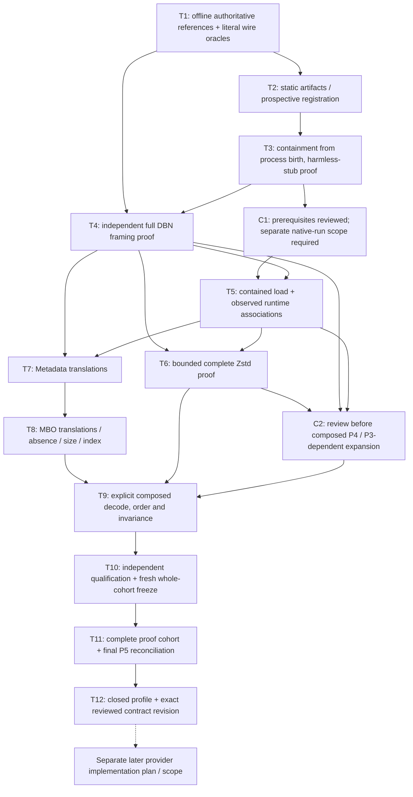

# Native/source-evidence P1–P5 proof-closure plan — 2026-10-12

## Current status and authority

**SAVED PLANNING PROPOSAL; all proof tasks UNEXECUTED.** At **2026-10-12T13:13:32Z** the human directly approved the [native/source-evidence contract](../docs/6E_NATIVE_SOURCE_EVIDENCE_CONTRACT_20261012.md) and requested this plan and [dated task list](native_source_evidence_p1_p5_todo_20261012.md), offline with accepted code unchanged. This releases documentation only. The existing window still ends **2026-10-12T15:12:16Z (16:12:16 Lisbon)**; planning is not another four-hour renewal.

The approved contract remains 40,693 raw bytes, SHA256 `290f11ae586e990885f63e84bd1b06c2fc083df83b3290b026b5c937e6792b35`. Its unchanged PROPOSED/stop-before-plans wording is earlier chronology; direct specification approval and this planning request supersede it for documentation, not for native/profile facts. P1–P5 remain unexecuted implementation blockers. Neither this saved plan, static review nor the earlier routine-approval waiver releases a native import, constructor, experiment, harness/fixture/test write, provider implementation or historical access.

Use new dated files only. Preserve `tasks/plan.md`, `tasks/todo.md`, all earlier typed-adapter task files, approved contracts and every pre-existing dirty/untracked change. Main used using-agent-skills, planning-and-task-breakdown, api-and-interface-design, documentation-and-adrs and security-and-hardening, including Definition of Done and Security Checklist. The human's explicit placement overrides the skills' default task filenames. No new routine approval request for an already approved contract is needed.

## Objective, completion boundary and assumptions

Close the five native-proof gaps for **one narrow invented complete in-memory member profile**, then freeze the exact profile/schema rules in a separately reviewed contract revision. This is a proof-closure plan, **not** the production provider's implementation plan.

Assumptions are explicit:

- Future proof input will be independently authored invented literal bytes/bodies only, with full target/foreign occurrences. No protected raw/historical/reserved prices, features, outcomes, archive members, old packets or downloaded market data.
- An authoritative version-bound format/codec source may or may not already be available offline. This has NOT been established. T1 must inventory an explicitly released local reference corpus. Installed annotations and encoder self-roundtrips do not supply missing authoritative layout or native semantics. If unavailable, retain the relevant blocker and report the exact missing evidence; no network acquisition or invented constants.
- The installed packages are not assumed to enforce the needed memory/window/time bounds. T3 and T6 must establish the specific enforcement mechanism or stop. No package installation/upgrade, Windows/security setting change or bypass is a fallback.
- Every numeric budget, required artifact set, executable, codec version, fixture body and source reference is prospectively locked in a future run registration. The contract's acceptance caps are not already verified peak-resource budgets.
- Proof harness code is a distinct future artifact, not the absent production `six_e_native_member_decode_evidence.py`. The present request does not create either.

A gate is closed only by independent reference/oracle evidence, complete registered observations and failure controls, stable pins, qualified process termination and review. A declaration, mock, measured example, passing subset or proposed task is not closure. P1–P5 closure still establishes bounded native **consistency**, not source/feed/runtime authentication, original book/event/feature parity, historical capacity/calendar/continuity, account integration, profitable strategy or model improvement.

## Held baseline and evidence boundaries

Read [project status](../PROJECT_STATUS.md), [workspace rules](../AGENTS.md) and [current window](../docs/6E_NATIVE_SOURCE_EVIDENCE_WINDOW_20261012.md) before old chronological dispatches.

The accepted typed adapter remains closed: 12,203 passed + exact three expected skips, all 12,206 case-sensitive unique identities = 10,872 old + 1,334 new; acceptance 2026-10-12T09:59:34Z. [Terminal receipt](../logs/typed_native_event_terminal_acceptance_20261012_1.json) is a dated snapshot, not another pending job. Do not poll session68085, recheck its exited processes or rerun accepted tests/controls/examples for status.

All **418 accepted Python files remain immutable**. Held canonical map: 45,454 bytes, SHA256 `2b0438e389dca5b5ffd3db0c483ead641fc771d941eb16164e0353a44f24c42c`; package `e82107504c0bce23a249bcba423e322c41b0367124d0c30f28327806b83f4b77`. [Raw freeze container](../logs/typed_native_event_full_freeze_20261012_1.json):45,569bytes, SHA256 `56ae5b99b0d382c531da9f637b5b00e34e6072bff3d4a9153fc71794a2a386d2`. No staging/commits/cleanup. Preserve old source/target/input/result/control pins and UNKNOWN liabilities. BTC/cloud collectors remain untouched.

## Why the gates are not executed in numeric order

P5 and P3 each have prerequisites and final empirical closure:

1. **P5-static:** independently register recognized on-disk artifacts and expected interpreter/package/proof-input pins without loading native code.
2. **P3-prerequisite:** review and demonstrate fail-closed containment from process birth, including native import initializers, before any controlled native load.
3. **P5-load:** inside that containment, observe registered loaded identity associations before the first corresponding constructor/parser call.
4. **P1/P2/P3/P4 experiments:** use frozen independent oracles to prove wire coverage, translations, resources/termination and complete composed decode behavior.
5. **P5-final:** reconcile the entire cohort and artifacts, then compute the final closed-profile identity and exact contract revision.

A **provisional experimental registration** is not a closed profile and never bypasses P1–P5 for production code. Requiring final empirical closure before the first contained experiment creates a cycle; invoking native code before static registration/containment creates an unsafe shortcut. The plan avoids both.



Arrows are future dependencies, not execution authorization. No diagram node is currently complete except preparation of this planning document.

## Twelve bounded tasks and four checkpoints

The [task list](native_source_evidence_p1_p5_todo_20261012.md) is the authoritative checklist, with acceptance, verification, dependencies, files and size for every task. Each future task is one focused slice; stop and split further if it exceeds roughly two hours or five files. Evidence collection may take more than one later window. No completion-date promise is inferred from remaining time today.

| Task | Deliverable and primary gate | Depends on |
| --- | --- | --- |
| T1 | Explicit offline authoritative-reference inventory and independently authored literal wire/body oracles; P1 prerequisite | Later proof scope; no task dependency |
| T2 | Complete provisional artifact/input/case registration; P5-static | T1 |
| T3 | Reviewed fail-closed process-birth containment, tested first with harmless non-native stubs; P3 prerequisite | T2 |
| C1 | Prerequisites reviewed, concrete budgets/owned-process policy locked; no native experiment unless separately released | T1–T3 |
| T4 | Independent complete DBN v3 framer and literal no-gap/no-extra wire proofs; P1 | T1–T3 |
| T5 | Contained native import and observed loaded identity association; P5-load | T2,T3,C1,T4 |
| T6 | Actual complete Zstd frame/span/termination and pre-allocation resource proof; P3 | T4,T5 |
| C2 | P1/P3 results and provisional native identity reviewed, failures retained | T4–T6 |
| T7 | All thirteen Metadata getter translations versus complete uncompressed wire bodies; P2 first slice | T4,T5,C1 |
| T8 | All seventeen MBO observations/domains/enum/ts_out/size/index rules; P2 second slice | T7 |
| T9 | Explicit continuous decoder behavior, complete order, tails and invariance; P4 | T4–T8,C2 |
| C3 | Native representation/decode proof candidates independently reviewed; no provider acceptance claim | T7–T9 |
| T10 | Independent complete oracle/source review, coverage registration and all-file freeze | T1–T9,C3 |
| T11 | Frozen complete proof cohort and final evidence/process/artifact reconciliation; P5-final | T10 |
| T12 | Canonical closed-profile body and exact reviewed specification revision; P1–P5 closure decision | T11 |
| C4 | Every gate has qualified evidence or remains explicitly blocked; later provider scope remains separate | T10–T12 |

Future failed attempts stay retained. Fix only separately authorized new proof artifacts, obtain independent review, re-register and rerun the affected complete evidence cohort. Never patch held code, silently change an oracle to match actual output, skip mandatory native cases or score a successful subset.

Before T6's first Zstd call, T1's oracle corpus must additionally contain independently referenced literal **compressed bytes, decompressed bytes and complete frame/span expectations**, pinned against an authoritative version-bound offline Zstd source. SDK compression output/roundtrips are supplemental only, never the sole expectation. If that reference/corpus is unavailable, T6/P3 stays blocked; this alone does not prohibit otherwise qualified uncompressed T7/T8 probes under T4/T5/C1. C2 gates composed T9/P4 and P3-dependent expansion, not that independent P2 branch.

## Future artifacts and ownership — none created now

`FRESH` below means a later root-registered unique run ID; it must never be executed or written literally. Resolve every actual artifact path and preserve previous attempts before any future release.

- Reference/fixture author: `docs/6E_NATIVE_PROFILE_REFERENCES_FRESH.md` and `tests/native_profile_oracles_FRESH.py`. Literal full byte/body expectations come from independently reviewed source references, not native constructors, returned getter values, production serializers or dataclass reflection.
- Harness author: `scripts/native_profile_probe_FRESH.py`; no accepted research-module imports, archive/path caller input or provider API implementation. Harness owns only explicitly registered invented corpus and experiment controls.
- Independent test author: `tests/test_native_profile_probe_FRESH.py`; may consume frozen literal oracles, never adopt harness projections as expected truth.
- Root only: scoped prospective registration and full attempt evidence below `logs/native_profile_FRESH/`, including reports, resource/owned-process receipts, full freeze manifest and final profile body.
- Read-only reviewer: complete new artifacts, independent oracle provenance, boundary/phase/framing/resource evidence and exact later contract revision. Review cannot provide native execution authority.

One owner per writable file. Literal-oracle and harness authors are separate; no shared mutable writer. Hold **all** proof writers during every focused/check/resource attempt and freeze old/new source/tests/oracles/registration throughout complete suites. Parallel work is safe for reference-body authoring versus containment documentation after interfaces are stable. P2 T7/T8 can use independently framed uncompressed DBN literals after T4/T5/C1 without waiting for P3 T6 decompression closure; P4 T9 requires both branches. This does not waive process-birth containment, loaded identity or per-run bounds for DBN calls. Root serializes native experiments and shared-harness edits; never run competing allocation probes simultaneously.

## Prospective execution and containment rules

This section is UNEXECUTED future design, not permission:

- Before any proof code/fixtures are written or a process launched, obtain a separately direct offline proof scope/window specifying new writable paths, invented inputs, allowed native imports/calls, exact budgets, registration/evidence outputs and stop time. Routine checkpoint approvals need not repeat the already approved contract; missing native/code authority remains a real boundary.
- Lock static expected artifacts, full input bytes/raw hashes, independent expected bodies, constructor options, exact intended case identities, resource enforcement policy and attempt command/executable/creation/parent. A PID alone never establishes ownership; reused PID or identity mismatch cannot authorize stopping a process.
- Enforce containment **before native import/initialization**, with reviewed guarantees for wall time and memory/window/expansion, not only observed peaks or post-allocation length checks. If the available OS/API cannot enforce the registered bound without forbidden changes, stop with P3/P5 blocked. Process-local containment is not permission to inspect/disable security settings.
- After contained load, reconcile the recognized loaded associations before the first corresponding Zstd/DBN constructor/parser. Refuse unverifiable identity or check/use mutation. Reconfirm DBN association before its constructor; import itself is already native execution.
- Register failures/timeouts/crashes as failed or unresolved attempts, never successful ValueError refusals. Stop only the exact retained identity-matched owned job under its prior stop policy; do not touch collectors or unrelated Python processes.
- Native-proof values need independent reference expectations before each run. Discovery observations can identify a missing rule but are not their own oracle or a closed gate.
- New profile rules preserve raw exact integers, native enum-versus-string/absence distinctions and every wire occurrence, with explicit full-body/hash/span namespaces. No guessed length=record_size/4, None/sentinel normalization, instrument1/genesis/window coercion or thinning.

P1/P3 spans must come from proven independent mechanisms, not feed chunks/decoder yields/record_size. Keep raw compressed-member spans, decompressed DBN spans, decoded positions and ZIP coordinates distinct; this provider has no ZIP coordinate. Require bijective complete occurrence/span association, no gaps/extras and every full translated value. Retain both framing ledgers and logical projections.

For identical full bytes/context/profile/runtime-manifest, feed partitioning must preserve complete evidence identity. Recompressed/reframed different bytes may preserve logical observations but change physical frames/raw hashes/full identity. No future terminal/member/runtime hash becomes an earlier causal publication input.

## Acceptance-group traceability — proof contributions, not provider acceptance

| Contract group | Planned proof contribution | Still required in later provider implementation |
| --- | --- | --- |
| A1 Context/preflight | T2,T3,T5,T9: registered context, identity and ordering mechanisms | Actual public expected-pin/context preflight and refusal before native work |
| A2 Complete input | T1,T4,T6: full byte identities/caps and invalid literal fixtures | Actual public bytes-only/shape/hash boundary |
| A3 Zstd completeness | T6: full frame ledger, cross-frame structures, truncation/tails/dictionary/skippable rules | Public integration and whole-result refusal |
| A4 Expansion/resources | T3,T6: enforcement from birth plus measured qualified adversarial controls | Provider uses the proven policy without post-check-only shortcuts |
| A5 Wire framing | T1,T4: literal full-wire bodies, truncation/unsupported tails even with empty native buffer | Provider independent-framer composition |
| A6 Explicit codec | T5,T9: explicit AS_IS/NONE/header/version/ts_out behavior | Public exact Context/protocol/profile checks |
| A7 Native header | T1,T7: all thirteen logical properties, ordered wire mapping bodies, dates/unset translations | Exact provider projection/body verification |
| A8 Complete positions | T4,T9: one first Metadata + every target/foreign MBO, no omitted tails/types | Complete public occurrence output/reconstruction |
| A9 Raw observations | T1,T8: all seventeen exact fields/domains/enum/absence | Exact provider raw-boundary/tamper refusal |
| A10 Size/index separation | T4,T8: raw wire length versus observed record_size/derived ts_index | No provider inferred offsets or sorting |
| A11 Chunk invariance | T6,T9: identical-byte partition invariance vs different re-encoding comparison | Complete public evidence identity invariance |
| A12 Terminal atomicity | T3,T6,T9: native late-failure mechanisms and harness staging discipline | Actual public all-or-nothing return/no callback/yield/cache adoption |
| A13 Submitted verification | T1,T10,T12: complete literal bodies and exact schema/hash namespaces | Actual public verifier, every submitted mutation and fresh reconstruction |
| A14 Identity/no hindsight | T1,T4,T6,T12: distinct physical/logical/terminal namespaces | Provider and any later causal bridge enforce future exclusion |
| A15 Full qualified handoff | T2,T10–T12: exact collected cohort/pins/reports/owned exits/resource evidence | Fresh provider cohort after implementation; no inherited acceptance |

**No A1–A15 checkbox is marked accepted merely by P1–P5 closure.** Mocks prove at most wrapper/harness behavior, not native EOF/ABI/resource guarantees or absent production APIs. The later provider remains unimplemented, even after every proof task passes.

## Future verification templates and evidence reconciliation

No command was run to implement or test this plan. Future templates require separately authorized scope, actual checked `FRESH` replacement, frozen files, independent oracles and owned/resource registration:

```powershell
.venv/Scripts/python.exe -B -m pytest -q tests/test_native_profile_probe_FRESH.py --junitxml=logs/native_profile_FRESH/focused.xml
.venv/Scripts/python.exe -B -m pytest -q --junitxml=logs/native_profile_FRESH/full.xml
.venv/Scripts/python.exe -m ruff check src tests scripts/native_profile_probe_FRESH.py
.venv/Scripts/python.exe -m ruff format --check scripts/native_profile_probe_FRESH.py tests/test_native_profile_probe_FRESH.py tests/native_profile_oracles_FRESH.py
```

The harness's exact native-run CLI/argv and enforceable controls are **not defined or executable yet**; T2/T3 must freeze them before any native launch. No build command is invented for this Python repository; syntax/import/runtime/native checks are later governed by the registered test/proof harness. Format checks never rewrite held files.

Root must reconcile complete bounded JUnit declared totals, every previous **12,206 case-sensitive identity** from the accepted report and exactly every independently collected new case, zero failures/errors, exact three old skip identities **and full XML reason representations**, raw report bytes/SHA, tool exit zero and exact identity-matched owned process exit. Preserve GZIP/gzip. New mandatory native proof cases cannot skip; unavailable required backend/resource control blocks closure. Do not guess a new count. Retain all negative cases, failed attempts and full resource/control receipts; a green summary alone proves neither completeness nor containment.

Whole old/new files, full package/artifact/provisional registration/oracle/input/report pins and manifest containers must match the freeze. Profile identity and runtime-manifest identity exclude fresh PID/time attempt metadata as required by the approved contract; these are separate owned-experiment receipts. No profile/body hash self-cycle or logical Metadata/raw header substitution. T12 freezes exact status values, enum/date/domain/absence rules, all named body schemas, counts/limits and complete canonical exclusions in a **new** reviewed contract revision, retaining this approved contract unchanged.

If **any P1–P5 blocker remains**, issue only a distinct blocked closure receipt (for example future `logs/native_profile_FRESH/blocked_profile_receipt.json`) naming missing evidence; do not emit a positive `closed_profile.json`, closed-profile digest or CLOSED contract revision. The successful closed-profile artifact is conditional on complete qualified closure of all five gates, never a partial-success summary.

## Risks, alternatives and stop conditions

| Risk | Consequence | Required response |
| --- | --- | --- |
| No authoritative version-bound evidence available offline | P1/P2 expected values unavailable | Block exact gate; request a separately scoped supplied reference, never browse/download here |
| Native initializer or decompressor allocates before controls | P3/P5 safety guarantee absent | Refuse experiment/profile; no OS/security/dependency workaround |
| Observed getter output becomes its own expectation | Circular P2 “proof” | Freeze independent literal/reference expectations first |
| Runtime checked after constructor, or disk pin called loaded proof | Native work outside registered identity | Enforce P5-static/load distinction and before-first-call association |
| Dictionary coalesces original wire mappings | Full-body evidence is lost | Keep ordered wire bodies; duplicate wire raw-symbol group keys refuse under this narrow profile |
| Post-output caps or measured peaks called pre-allocation bounds | False safety claim | Separate enforced budget from observed measurement; retain blocker if enforcement unproved |
| Same-byte chunk invariance confused with new compression | Invalid whole-identity comparison | Compare logical and physical namespaces separately |
| Full gate closure called provider/history acceptance | Unauthorized release or untested API claims | Preserve traceability residuals and separate scope/plan |
| Deadline pressure | Skips/subsets/late owned jobs | Leave unfinished, honor run stop policy, retain evidence; never weaken gates |

Rejected alternatives: reuse the old historical generator, infer wire length from native object size, normalize unknown timestamps into held transport, accept an empty decoder buffer as EOF, use one encoder/decoder roundtrip as the oracle, or integrate archive+book+features+accounts in this proof plan.

## Current documentation definition of done and handoff

Today only these two dated planning files and accurate current-status/window/rules references may change. Done means approved-contract-derived small tasks, acyclic dependencies, P1–P5/A1–A15 coverage with honest residuals, independent static review, working local links, unchanged held code/contracts/plans, no staged paths and a clear final handoff. It does **not** require repeating accepted suites, native calls or dependency/security audits.

Present the saved plan/task list and stop before proof execution. Future native-proof scope and exact registration are still needed; after proof closure a separate provider implementation plan/scope remains needed. All28contract authorities stay literalFalse. No history/source/runtime authentication, training/scoring/promotion or actual orders follow. At the original15:12:16UTC hard end launch nothing, summarize verified docs/gaps, delete the heartbeat and stop.
